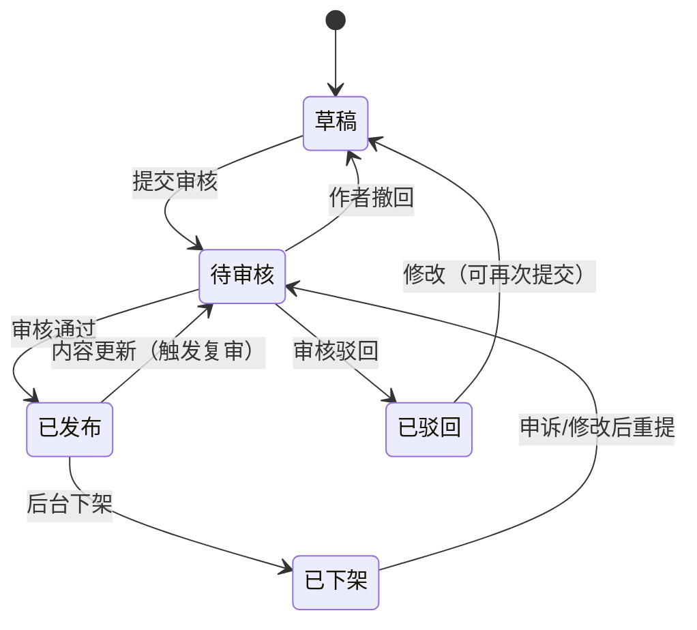

# 喵站 · 编程学习网站 任务书（需求文档）

| 文档信息 | |
| --- | --- |
| 项目名称 | 喵站（编程学习网站） |
| 文档版本 | v1.3 |
| 文档状态 | 评审稿 |
| 当前阶段 | 开发版（Development） |
| 编写日期 | 2026-09-30 |
| 修订日期 | 2026-10-13（§15.13 分层加载再下一层：点开哪一章拉哪一章；§16.2 加课规矩补 `boot`/`assemble`）｜2026-10-10（§15.11 英语入门 200 词、§15.12 首屏改按需加载；§16 常设规则改写「加一门课」的流程） |
| 适用范围 | 本任务书覆盖「开发版」全量需求；上线版仅做方向性规划 |
| ⚠️ 阅读前提 | §2 / §8 / §10 / §11 里凡是涉及**账号、投稿审核、后台管理、数据库、后端接口**的条目，自 2026-10-06 起已作废，实情见 §15.10。历史条目保留不删，以日志为准 |

---

## 1. 项目概述

### 1.1 背景与定位

喵站是一个**编程学习网站**，以结构化图文教程为核心内容形态：

- **内容形态参考菜鸟教程（runoob）**：按「教程 → 章节 → 知识点文章」组织的体系化编程教程，覆盖多门语言/技术栈，每篇内容短小聚焦、配代码示例。
- **使用方式与信息架构参考 B 站的文档（专栏）模式**：首页分区推荐 + 顶部分类导航 + 全局搜索；阅读页三栏布局（左侧目录树 / 中间正文 / 右侧大纲与作者卡）；用户可投稿创作，创作需审核，配创作中心与消息通知。

一句话定位：**像刷 B 站专栏一样刷编程教程，人人可申请成为教程作者。**

### 1.2 项目目标

1. 提供体系化、可检索、可追踪进度的编程教程阅读体验。
2. 建立「用户 → 老师 → 审核」的内容生产闭环，保证内容质量可控。
3. 当前阶段交付**开发版**：完成两个核心模块 —— **喵站（前台）** 与 **后台管理系统**，跑通全部功能闭环，达到可内部试用标准。

### 1.3 名词定义

| 名词 | 定义 |
| --- | --- |
| 教程 | 一门完整课程，含元信息（标题/分类/封面/简介/难度/标签）与若干章节 |
| 章节 | 教程下的单篇图文内容（Markdown），最小阅读单元 |
| 老师 | 通过申请审核、获得教程发布权限的用户 |
| 审核 | 后台对「老师申请 / 新教程 / 教程更新 / 举报」进行的通过/驳回操作 |
| 游客 | 未登录状态的访问者 |
| 前台 / 喵站 | 面向所有用户的内容展示与浏览入口 |
| 后台 / 管理系统 | 面向审核员与管理员的管理操作入口 |

---

## 2. 角色与权限模型

### 2.1 角色定义

| 角色 | 说明 | 获得方式 |
| --- | --- | --- |
| 游客 | 未登录访问者 | 默认 |
| 注册用户（学员） | 已登录普通用户 | 邮箱注册 |
| 老师 | 可创作并提交教程的用户 | 申请 + 后台审核通过 |
| 审核员 | 处理审核队列、举报 | 管理员授权 |
| 管理员 | 拥有全部后台权限 | 系统初始化指定 |

### 2.2 权限矩阵（前台 + 后台）

| 功能 | 游客 | 注册用户 | 老师 | 审核员 | 管理员 |
| --- | --- | --- | --- | --- | --- |
| 浏览首页/分类/教程/章节 | ✅ | ✅ | ✅ | ✅ | ✅ |
| 全局搜索 | ✅ | ✅ | ✅ | ✅ | ✅ |
| 注册/登录/找回密码 | ✅ | — | — | — | — |
| 学习进度云端同步 | ❌（仅本地） | ✅ | ✅ | ✅ | ✅ |
| 收藏 / 笔记 | ❌ | ✅ | ✅ | ✅ | ✅ |
| 申请成为老师 | ❌ | ✅ | — | — | — |
| 创建/编辑/提交教程 | ❌ | ❌ | ✅ | ❌ | ✅ |
| 查看自己教程的审核状态与数据 | ❌ | ❌ | ✅ | ❌ | ✅ |
| 审核老师申请 / 教程 / 更新 | ❌ | ❌ | ❌ | ✅ | ✅ |
| 处理举报 | ❌ | ❌ | ❌ | ✅ | ✅ |
| 用户管理（封禁/角色） | ❌ | ❌ | ❌ | ❌ | ✅ |
| 分类/标签/公告/轮播管理 | ❌ | ❌ | ❌ | ❌ | ✅ |
| 后台账号与权限管理 | ❌ | ❌ | ❌ | ❌ | ✅ |
| 查看操作日志 | ❌ | ❌ | ❌ | ❌ | ✅ |

---

## 3. 总体信息架构

### 3.1 站点地图 —— 前台（喵站）

```
首页
├── 分类导航（按技术分区：前端 / 后端 / 移动端 / 数据库 / 运维 / AI ...）
│   └── 分类页（该分类下教程列表：最新 / 最热 / 难度筛选）
├── 教程封面页（简介、目录、作者卡、学习人数）
│   └── 章节阅读页（三栏：目录树 / 正文 / 大纲 + 上一篇·下一篇）
├── 搜索结果页（教程 / 章节 / 作者 三个 Tab）
├── 登录 / 注册 / 找回密码（可跳过，继续游客浏览）
├── 个人中心（右上角头像进入）
│   ├── 个人资料
│   ├── 我的学习（学习进度 / 收藏 / 笔记）
│   ├── 消息中心
│   ├── 申请成为老师 / 申请进度
│   ├── 创作中心（仅老师可见）
│   │   ├── 我的教程列表
│   │   ├── 教程编辑器（新建 / 编辑 / 章节管理）
│   │   └── 数据概览（阅读量 / 收藏 / 完成率）
│   └── 账号设置（改密码 / 换绑邮箱 / 注销）
└── 404 / 500 / 维护页
```

### 3.2 站点地图 —— 后台管理系统

```
后台登录页（独立账号体系鉴权）
├── 仪表盘（待审数量 / 今日新增 / 趋势图）
├── 审核中心
│   ├── 老师申请审核
│   ├── 新教程审核
│   ├── 教程更新审核
│   └── 举报处理
├── 内容管理（教程列表：上架 / 下架 / 推荐位 / 分类调整）
├── 用户管理（列表 / 详情 / 封禁·解封 / 角色调整）
├── 分类与标签管理
├── 运营位管理（首页轮播 / 公告）
├── 数据统计（用户 / 内容 / 学习行为）
├── 系统设置（审核规则文案 / 协议维护 / 限流参数）
└── 操作日志
```

### 3.3 全局导航规则

- 顶部导航恒显：**Logo ｜ 分类入口 ｜ 全局搜索框 ｜ 消息图标 ｜ 头像区（右上角个人信息中心）**。
- 右上角头像区两种状态：
  - 未登录：「登录 / 注册」按钮 + 「跳过，继续浏览」入口。
  - 已登录：头像 + 下拉菜单（个人资料 / 我的学习 / 消息中心 / 创作中心*老师* / 申请成为老师*非老师* / 账号设置 / 退出登录）。
- 后台管理系统使用独立域名或独立路由前缀（如 `/admin`），与前台完全分离的会话与布局。

---

## 4. 版本规划

| 版本 | 范围 | 目标 |
| --- | --- | --- |
| **开发版（当前）** | 两个核心模块：`dev/frontend`（前台）、`dev/backend` | 跑通全部功能闭环，内部可试用；数据可用 SQLite 本地库 |
| 上线版 | 开发版功能 + 生产化（正式数据库、对象存储、CDN、邮件服务、监控、备案合规） | 对外发布 |

开发版目录约定：

```
喵站/                          ← 项目根（可位于任意磁盘路径）
├── SPEC.md                    ← 本文档
├── DEPLOY.md                  ← 部署与开源托管指南
├── dev/                       ← 开发版（当前阶段）
│   ├── frontend/              ← 核心模块①：前台（内容展示与浏览入口）
│   ├── backend/               ← 核心模块②：后端服务与后台管理
│   ├── tests/                 ← 接口 / 后台 / UI 三套测试
│   └── PLAN.md                ← 前台 UI 计划书
└── prod/                      ← 上线版（后续阶段）
```

---

## 5. 端到端功能流程

> 本节列出从用户进入到各功能闭环的全部流程。F 编号为流程编号，供开发与测试引用。

### F1 游客浏览主流程（可跳过登录）

1. 用户进入首页 → 展示轮播、推荐教程、各分类热门、最新上架。
2. 点击分类 → 分类页 → 筛选/排序 → 点击教程 → 教程封面页。
3. 点击「开始学习」→ 章节阅读页 → 上一篇/下一篇连贯阅读。
4. 触发需登录行为（收藏 / 笔记 / 进度同步 / 评论*P1*）→ 弹出登录引导层。
5. 引导层提供：「去登录 / 去注册 / **暂不登录，继续浏览**」——游客可跳过，继续阅读不受影响。
6. 游客限制：学习进度仅存浏览器本地；收藏、笔记、评论不可用；关闭页面后本地进度可选保留。

### F2 注册与登录闭环（邮箱体系）

**注册：**
1. 登录页切换至「注册」→ 输入昵称、邮箱、密码（两次确认）。
2. 点击「发送验证码」→ 60s 倒计时防重发 → 邮箱收到 6 位验证码（10 分钟有效）。
3. 输入验证码 → 勾选《用户协议》与《隐私政策》→ 提交。
4. 校验通过 → 注册成功并自动登录 → 跳回来源页。
5. 若此前为游客且本地有学习进度 → 提示「检测到本地学习记录，是否合并到账号？」→ 合并/放弃。

**登录：**
1. 邮箱 + 密码登录；或邮箱 + 验证码快捷登录。
2. 连续 5 次密码错误 → 锁定 15 分钟并提示走「忘记密码」。
3. 登录成功 → 跳回来源页；若来源页为后台 → 校验后台角色，无权限则拒绝。

**忘记密码：**
1. 输入邮箱 → 验证码 → 设置新密码 → 原会话全部失效。

**状态与异常：** 验证码收不到（重发 / 检查垃圾箱提示 / 更换邮箱）、验证码错误 5 次失效、邮箱已注册引导直接登录、网络异常可重试不丢输入。

### F3 学习浏览闭环

1. 分类导航 → 教程封面页（简介 / 章节目录 / 作者卡 / 学习人数 / 难度 / 最近更新）。
2. 「开始学习」或点选章节 → 阅读页：
   - 左侧：教程目录树（当前章节高亮、已完成章节打勾）。
   - 中间：正文（Markdown 渲染、代码高亮、一键复制代码、图片放大）。
   - 右侧：本篇大纲锚点 + 作者卡 + 「上一篇 / 下一篇」。
3. 滚动到底部或点击「标记完成」→ 记录学习进度（登录用户写云端，游客写本地）。
4. 阅读中可：收藏教程、对当前章节写笔记（私有）、回到目录。
5. 完成全部章节 → 教程标记「已学完」→ 封面页与个人中心展示完成徽章。
6. 中途退出 → 再次进入该教程 → 自动定位到上次学习章节并提示「继续学习」。

### F4 搜索闭环

1. 全局搜索框输入 → 下拉联想（教程名 / 章节标题 / 作者）。
2. 回车 → 结果页三个 Tab：教程 / 章节 / 作者。
3. 支持筛选：分类、难度、更新时间；排序：相关度 / 最新 / 最热。
4. 点击结果 → 直达封面页或具体章节（章节结果高亮命中词）。
5. 无结果 → 展示相近词纠错 + 热门推荐 + 「求教程」反馈入口*P1*。
6. 登录用户保留最近 10 条搜索历史，可清空。

### F5 个人中心闭环（右上角入口）

1. 点击右上角头像 → 下拉菜单 / 个人中心首页。
2. 个人资料：修改昵称、头像、简介；查看角色身份（学员 / 老师）。
3. 我的学习：学习中的教程（含进度条）、已学完、收藏列表、笔记列表（可跳转回原章节锚点）。
4. 消息中心：系统通知、审核结果通知、互动通知*P1*；支持全部已读。
5. 账号设置：修改密码（需旧密码）、换绑邮箱（双邮箱验证）、账号注销（7 天冷静期）。

### F6 老师申请闭环

1. 入口：个人中心「申请成为老师」（已是老师则显示「创作中心」）。
2. 申请表：真实称呼、擅长技术领域（多选）、个人介绍、**样例作品**（在线编写或粘贴链接）、勾选《内容创作协议》。
3. 提交 → 状态「审核中」，期间不可重复提交，可在申请进度页查看或**撤回**。
4. 后台审核（见 F8）→ 结果以站内消息 + 邮件通知：
   - **通过** → 角色升级为老师，个人中心出现「创作中心」，申请页展示欢迎引导。
   - **驳回** → 展示驳回原因，允许修改资料后**重新提交**（同一用户 30 天内最多提交 3 次）。

### F7 教程创作与发布闭环（老师）

1. 创作中心 → 「新建教程」→ 填写元信息：标题、分类、标签、封面、简介、难度、适合人群。
2. 进入编辑器 → 章节管理（增删、拖拽排序）→ 单章编辑：Markdown 编辑器 + 实时预览 + 草稿自动保存（本地 + 云端双保险）。
3. 全部章节就绪 → 「提交审核」→ 状态机流转：



4. 审核期间：内容锁定只读；作者可「撤回」回草稿。
5. 审核通过 → 教程上架，出现在分类页 / 搜索 / 首页推荐候选池；作者收到通知。
6. 已发布教程的**任何内容变更需重新提交审核**；审核期间线上保留旧版本，新内容通过后无缝替换（用户端无感知）。
7. 数据概览：阅读量、收藏数、学习完成率、章节完读率，按日更新。

### F8 后台审核闭环

1. 审核员登录后台 → 仪表盘显示各待审队列数量。
2. 进入对应队列（老师申请 / 新教程 / 教程更新 / 举报），列表支持：提交时间排序、按申请人/分类筛选、认领（防多人同时审同一单）。
3. 审核详情页：
   - 老师申请：申请资料 + 样例作品内容 + 该用户历史记录。
   - 教程：元信息 + 全部章节正文渲染预览 + 与上一版本差异对比（更新审核时）。
   - 对照《内容审核规范》（第 7 章）检查清单逐项确认。
4. 操作：**通过** / **驳回（必选预设原因模板 + 可补充说明）**；驳回原因将原文同步给作者。
5. 提交 → 写入审核日志（操作人、时间、结论、原因）→ 触发站内消息 + 邮件通知申请人。
6. 支持批量通过（仅限明显合规项，如低风险举报结案）；批量操作二次确认。

### F9 用户与运营管理闭环（管理员）

1. 用户管理：搜索用户 → 查看详情（角色、教程、违规记录）→ 封禁（选期限 + 原因）/ 解封 / 调整角色（含授予、取消老师资格，取消其全部教程下架联动）。
2. 举报处理：用户对教程/章节发起举报（选择类型：违法违规 / 抄袭 / 广告 / 内容错误 / 其他）→ 进入举报队列 → 审核员核实 → 处理结果（下架 / 驳回举报 / 警告作者）→ 通知举报人与被举报人。
3. 分类与标签管理：增删改、排序、合并标签；分类调整自动迁移教程归属。
4. 运营位管理：首页轮播与公告的上下架、排序、定时生效。
5. 操作日志：后台一切写操作留痕，可按人 / 按对象 / 按时间检索。

### F10 边界与异常流程

| 场景 | 处理 |
| --- | --- |
| 账号被封禁后登录 | 提示封禁原因与期限，前台全部只读，创作入口隐藏 |
| 老师资格被取消 | 其名下教程全部下架（保留数据），前台身份变回学员 |
| 审核中作者撤回 | 队列中该单标记「已撤回」，审核员不可再操作 |
| 同一账号多地登录 | 后登录挤掉前会话（学习类站点默认允许 2 端并存，可在设置中查看登录设备并踢出） |
| 草稿丢失 | 编辑器每 30s 自动保存云端 + 本地 localStorage 双备份，异常关闭后恢复提示 |
| 邮件服务不可用 | 验证码接口降级：返回明确错误并允许稍后重试，不吞用户输入 |
| 游客转注册 | 本地学习进度合并策略见 F2-注册-5 |

---

## 6. 页面清单与模块规划

### 6.1 前台（喵站）页面清单

| 编号 | 页面 | 建议路由 | 核心模块 | 权限 |
| --- | --- | --- | --- | --- |
| P-01 | 首页 | `/` | 轮播、推荐教程、分类热门、最新上架、页脚 | 全部 |
| P-02 | 分类页 | `/category/:id` | 教程卡片列表、难度/排序筛选、分页 | 全部 |
| P-03 | 教程封面页 | `/tutorial/:id` | 简介、章节目录、作者卡、学习人数、开始学习/继续学习 | 全部 |
| P-04 | 章节阅读页 | `/tutorial/:id/:chapterId` | 左目录树、正文渲染、代码复制、右大纲、上下篇、收藏、笔记、标记完成 | 全部（交互项需登录） |
| P-05 | 搜索结果页 | `/search?q=` | 三 Tab、筛选、纠错、历史 | 全部 |
| P-06 | 登录 | `/login` | 密码登录、验证码登录、跳过入口 | 游客 |
| P-07 | 注册 | `/register` | 邮箱验证码、协议勾选 | 游客 |
| P-08 | 找回密码 | `/reset-password` | 验证码 + 重置 | 游客 |
| P-09 | 个人资料 | `/u/profile` | 昵称/头像/简介编辑 | 登录 |
| P-10 | 我的学习 | `/u/learning` | 学习中/已学完/收藏/笔记 | 登录 |
| P-11 | 消息中心 | `/u/messages` | 通知列表、已读管理 | 登录 |
| P-12 | 老师申请页 | `/u/apply-teacher` | 申请表单 / 申请进度 / 驳回原因 | 登录 |
| P-13 | 创作中心 - 教程列表 | `/studio/tutorials` | 状态分组列表、新建入口、数据列 | 老师 |
| P-14 | 创作中心 - 编辑器 | `/studio/editor/:id` | 元信息表单、章节管理、Markdown 编辑器、预览、提交审核/撤回 | 老师 |
| P-15 | 创作中心 - 数据概览 | `/studio/stats` | 阅读量/收藏/完成率图表 | 老师 |
| P-16 | 账号设置 | `/u/settings` | 改密码、换绑邮箱、登录设备、注销 | 登录 |
| P-17 | 异常页 | `404 / 500` | 返回首页、搜索建议 | 全部 |

全局组件：顶部导航栏（含搜索与头像区）、登录引导弹层、页脚（关于 / 协议 / 联系方式）、回到顶部、举报弹窗。

### 6.2 后台管理系统页面清单

| 编号 | 页面 | 建议路由 | 核心模块 | 权限 |
| --- | --- | --- | --- | --- |
| A-01 | 后台登录 | `/admin/login` | 账号密码 + 图形验证码 | 审核员/管理员 |
| A-02 | 仪表盘 | `/admin` | 待审卡片、今日新增、7 日趋势图 | 审核员/管理员 |
| A-03 | 老师申请审核 | `/admin/review/teacher` | 队列、详情、通过/驳回 | 审核员/管理员 |
| A-04 | 教程审核（新/更新） | `/admin/review/tutorials` | 队列、全文预览、版本 Diff、通过/驳回 | 审核员/管理员 |
| A-05 | 举报处理 | `/admin/reports` | 队列、证据详情、处理动作 | 审核员/管理员 |
| A-06 | 内容管理 | `/admin/content` | 教程检索、上架/下架、推荐位设置 | 管理员 |
| A-07 | 用户管理 | `/admin/users` | 检索、详情、封禁、角色调整 | 管理员 |
| A-08 | 分类与标签 | `/admin/taxonomy` | 树形管理、合并、排序 | 管理员 |
| A-09 | 运营位管理 | `/admin/ops` | 轮播、公告、定时上下架 | 管理员 |
| A-10 | 数据统计 | `/admin/stats` | 用户增长、内容量、学习行为 | 管理员 |
| A-11 | 系统设置 | `/admin/settings` | 审核文案、协议、限流参数 | 管理员 |
| A-12 | 操作日志 | `/admin/logs` | 多条件检索、详情 | 管理员 |

---

## 7. 内容审核规范（审核员执行依据）

### 7.1 审核检查清单

1. **合规红线**：违法违规、政治敏感、色情暴力、赌博诈骗 → 一律驳回并记录，情节重封号。
2. **版权**：明显抄袭/洗稿、未授权转载 → 驳回；要求作者声明原创或附授权。
3. **广告与导流**：站外引流二维码、推广链接泛滥 → 驳回。
4. **内容质量底线**：与标题不符、内容空洞（如纯 Hello World 拼凑）、代码无法运行且未说明 → 驳回。
5. **安全**：恶意代码（病毒、钓鱼、破坏型脚本）→ 驳回 + 警告；教学用安全示例需有明确提示。
6. **排版规范**：Markdown 结构完整、代码块标注语言、图片可访问。

### 7.2 驳回原因模板（预设）

- 内容违规（含具体条款）
- 涉嫌抄袭/未授权转载
- 含站外导流或广告
- 内容质量不达标（说明具体缺口）
- 代码存在安全风险
- 其他（自定义说明，必填）

### 7.3 处罚梯度

提醒 → 驳回并警告 → 教程下架 → 取消老师资格 → 封禁账号。每步均留日志并通知当事人；作者对下架/取消资格可发起一次**申诉**，由管理员复核。

---

## 8. 功能需求清单（FR）

> P0 = 开发版必须；P1 = 开发版尽量；P2 = 上线版候选。

### 8.1 认证与账号（AUTH）

| 编号 | 需求 | 优先级 |
| --- | --- | --- |
| FR-AUTH-01 | 邮箱 + 验证码注册（昵称、密码、协议勾选） | P0 |
| FR-AUTH-02 | 邮箱 + 密码登录 | P0 |
| FR-AUTH-03 | 邮箱 + 验证码快捷登录 | P1 |
| FR-AUTH-04 | 忘记密码（验证码重置） | P0 |
| FR-AUTH-05 | 登录引导弹层「跳过，继续浏览」 | P0 |
| FR-AUTH-06 | 连续错误锁定与验证码防刷限流 | P0 |
| FR-AUTH-07 | 修改密码 / 换绑邮箱 / 账号注销（冷静期） | P1 |
| FR-AUTH-08 | 游客本地进度合并到账号 | P1 |

### 8.2 浏览与学习（LEARN）

| 编号 | 需求 | 优先级 |
| --- | --- | --- |
| FR-LEARN-01 | 首页（轮播 / 推荐 / 分类热门 / 最新） | P0 |
| FR-LEARN-02 | 分类导航与分类页（筛选 / 排序 / 分页） | P0 |
| FR-LEARN-03 | 教程封面页（目录 / 作者卡 / 开始学习） | P0 |
| FR-LEARN-04 | 章节阅读页三栏布局、上下篇导航 | P0 |
| FR-LEARN-05 | Markdown 渲染、代码高亮、一键复制 | P0 |
| FR-LEARN-06 | 学习进度记录与「继续学习」定位 | P0 |
| FR-LEARN-07 | 收藏教程 | P0 |
| FR-LEARN-08 | 章节笔记（私有，可回跳锚点） | P1 |
| FR-LEARN-09 | 完成徽章 / 已学完标记 | P1 |

### 8.3 搜索（SEARCH）

| 编号 | 需求 | 优先级 |
| --- | --- | --- |
| FR-SEARCH-01 | 全局搜索（教程/章节/作者） | P0 |
| FR-SEARCH-02 | 结果页 Tab + 筛选 + 排序 | P0 |
| FR-SEARCH-03 | 输入联想 | P1 |
| FR-SEARCH-04 | 搜索历史与无结果推荐 | P1 |

### 8.4 个人中心（UC）

| 编号 | 需求 | 优先级 |
| --- | --- | --- |
| FR-UC-01 | 右上角头像下拉菜单（含角色相关入口） | P0 |
| FR-UC-02 | 个人资料编辑 | P0 |
| FR-UC-03 | 我的学习（进度/收藏/笔记聚合） | P0 |
| FR-UC-04 | 消息中心（系统/审核通知） | P0 |
| FR-UC-05 | 全部已读、通知分类 Tab | P1 |

### 8.5 老师与创作（TEACH）

| 编号 | 需求 | 优先级 |
| --- | --- | --- |
| FR-TEACH-01 | 老师申请表单与进度页 | P0 |
| FR-TEACH-02 | 申请撤回与驳回后重提（30 天 ≤ 3 次） | P0 |
| FR-TEACH-03 | 创作中心教程列表（按状态分组） | P0 |
| FR-TEACH-04 | 教程元信息编辑 | P0 |
| FR-TEACH-05 | 章节管理（增删、排序） | P0 |
| FR-TEACH-06 | Markdown 编辑器 + 实时预览 + 自动保存 | P0 |
| FR-TEACH-07 | 提交审核 / 审核中撤回 | P0 |
| FR-TEACH-08 | 已发布内容更新触发复审、线上保留旧版 | P0 |
| FR-TEACH-09 | 驳回原因展示与修改后重提 | P0 |
| FR-TEACH-10 | 创作数据概览 | P1 |

### 8.6 后台管理（ADMIN）

| 编号 | 需求 | 优先级 |
| --- | --- | --- |
| FR-ADMIN-01 | 后台独立登录与角色鉴权 | P0 |
| FR-ADMIN-02 | 仪表盘待审统计 | P0 |
| FR-ADMIN-03 | 老师申请审核（通过/驳回+原因） | P0 |
| FR-ADMIN-04 | 教程审核（新提交 / 更新） | P0 |
| FR-ADMIN-05 | 更新审核的版本差异对比 | P1 |
| FR-ADMIN-06 | 审核认领与冲突提示 | P1 |
| FR-ADMIN-07 | 举报处理闭环 | P1 |
| FR-ADMIN-08 | 内容管理（上架/下架/推荐位） | P0 |
| FR-ADMIN-09 | 用户管理（封禁/解封/角色调整） | P0 |
| FR-ADMIN-10 | 分类与标签管理 | P0 |
| FR-ADMIN-11 | 运营位（轮播/公告）管理 | P1 |
| FR-ADMIN-12 | 操作日志留痕与检索 | P0 |
| FR-ADMIN-13 | 数据统计看板 | P2 |

### 8.7 互动（P1 起，可整体后置）

| 编号 | 需求 | 优先级 |
| --- | --- | --- |
| FR-SOC-01 | 章节评论 | P1 |
| FR-SOC-02 | 教程评分 | P2 |
| FR-SOC-03 | 「求教程」反馈 | P2 |

---

## 9. 非功能需求

| 类别 | 要求 |
| --- | --- |
| 性能 | 首屏 < 2s（本地开发环境除外按生产指标定）；阅读页打开 < 1.5s；列表分页 ≤ 20/页 |
| 安全 | 密码 Argon2/bcrypt 加密；会话 JWT + 刷新令牌；验证码/登录/提交审核接口限流；富文本渲染 XSS 白名单过滤；后台全部接口服务端鉴权；CSRF 防护 |
| 隐私 | 邮箱在界面展示脱敏（`f***@xx.com`）；注销后按协议删除或匿名化个人数据 |
| SEO | 教程与章节页支持 SSR 或预渲染；语义化 HTML；自动生成 sitemap |
| 兼容性 | Chrome / Edge / Firefox / Safari 最近两个大版本；移动端响应式可读 |
| 可用性 | 表单错误就地提示；危险操作二次确认；网络失败不丢用户输入 |
| 数据 | 开发版 SQLite；每日逻辑备份；后台写操作全量日志 |

---

## 10. 数据实体草案

| 实体 | 关键字段 |
| --- | --- |
| user | id, email, password_hash, nickname, avatar, role(student/teacher/reviewer/admin), status, created_at |
| email_code | id, email, code, scene(register/login/reset), expires_at, used |
| teacher_application | id, user_id, fields(json), status(pending/approved/rejected/withdrawn), reason, reviewed_by, reviewed_at |
| category | id, name, slug, sort, parent_id |
| tag | id, name |
| tutorial | id, author_id, title, category_id, cover, intro, difficulty, status(状态机见 F7), version, published_at |
| chapter | id, tutorial_id, title, content_md, sort, status |
| tutorial_version | id, tutorial_id, snapshot(json), status, submitted_at（用于更新复审与线上旧版保留） |
| review_record | id, target_type, target_id, reviewer_id, action, reason, created_at |
| learning_progress | id, user_id(可空→游客本地), tutorial_id, chapter_id, completed, updated_at |
| favorite | id, user_id, tutorial_id, created_at |
| note | id, user_id, chapter_id, content, anchor, created_at |
| message | id, user_id, type, title, body, read, created_at |
| report | id, reporter_id, target_type, target_id, type, detail, status, handled_by |
| announcement / banner | id, title, content/image, link, sort, starts_at, ends_at |
| admin_log | id, admin_id, action, target, detail, ip, created_at |

---

## 11. 技术架构建议（待主管拍板）

| 层 | 方案 A（推荐，与 Mindbox 技术亲和） | 方案 B |
| --- | --- | --- |
| 前端 | Vue 3 + Vite + Pinia + Vue Router；阅读页 SSR/预渲染选 Nuxt | React + Next.js |
| 后台 UI | Element Plus（管理端表格表单快） | Ant Design React |
| 后端 | Python FastAPI + SQLAlchemy | Node NestJS |
| 数据库 | 开发版 SQLite → 上线版 PostgreSQL/MySQL | 同左 |
| 全文搜索 | 开发版 SQLite FTS5 → 上线 Meilisearch | 同左 |
| Markdown | 渲染统一管线 + Shiki/highlight.js 代码高亮；编辑器 Vditor / md-editor-v3 | 同左 |
| 邮件 | 开发版 SMTP 直连（或 MailHog 本地捕获）→ 上线版邮件服务 | 同左 |
| 部署 | 开发版本地起服务 → 上线版 Docker + Nginx | 同左 |

---

## 12. 验收标准（开发版）

1. F1–F9 全部主流程可按本文档步骤走通，无阻断性缺陷。
2. 权限矩阵逐项核对通过：越权访问前后台接口均被拒绝并正确提示。
3. 教程状态机（F7）全部流转路径有对应界面与通知触达。
4. 审核驳回必须带预设原因，且作者端可见原文。
5. 游客全流程不强制登录，跳过入口始终可见。
6. 后台所有写操作在操作日志中可查。
7. 第 8 章全部 P0 项完成；P1 项完成度 ≥ 70%，未完成项列入上线版清单。

---

## 13. 里程碑

| 里程碑 | 内容 | 验收 |
| --- | --- | --- |
| M1 骨架与认证 | 两模块工程初始化、路由、布局、注册/登录/找回 | F2 走通 |
| M2 内容浏览 | 首页、分类、封面页、阅读页、搜索 | F1/F3/F4（游客）走通 |
| M3 个人中心 | 资料、我的学习、消息、进度同步 | F5 走通 |
| M4 老师申请与创作 | 申请流、创作中心、编辑器、提交审核 | F6、F7（提交前）走通 |
| M5 后台审核与管理 | 审核队列、驳回通知、用户/分类/内容管理 | F8、F9 走通 |
| M6 联调验收 | 全流程回归、权限核对、文档补齐 | 第 12 章全过 |

---

## 14. 风险与开放问题

| 项 | 说明 | 建议 |
| --- | --- | --- |
| 评论功能是否进开发版 | 当前定为 P1，范围大 | M3 评审时再定 |
| 视频教程 | 本期仅图文，不支持视频 | 上线版再议 |
| 审核 SLA | 待审积压体验差 | 后台设 48h 超时提醒*P1* |
| 内容冷启动 | 无老师时无内容 | 管理员账号兼任首批作者，预置 3–5 门基础教程 |
| 邮件送达率 | 验证码进垃圾箱影响注册转化 | 注册页加引导提示；上线版换专业邮件服务 |

---

## 15. 进度与决策日志

### 15.1 2026-10-04 · 英语 48 音标音频错位修复

| 项 | 内容 |
| --- | --- |
| 现象 | 音标卡片点下去播放的声音与标注不符；不听也能证明：`/iː/` 与 `/e/` 同指 `07.mp3`，`/uː/` 与 `/ʌ/` 同指 `09.mp3`，`02.mp3`、`04.mp3` 从未被引用 |
| 根因 | `en-data.js` 的「音标→文件」映射假设视频按「先 5 长元音再 7 短元音」朗读，实际是照表格**两列逐列成对**朗读（ɑː ʌ \| ɔː ɒ \| …） |
| 结论 | 按羽毛指针的真实朗读顺序重切 48 段音频并重写映射 ✅已定 |
| 依据 | 用户提供的源视频 `share_4cfc90489712e7174188d73b785d2612.mp4`（69.5s，抖音《48个音标的正确读音》） |

**改了什么**

- `dev/backend/phonemes/01-48.mp3`：全部重切（44.1kHz 单声道 64k，与原格式一致；峰值锚定裁剪 + 130Hz 高通 + 响度对齐）。
- `dev/backend/en-data.js`：48 条 `a` 字段重映射；文件头注释改写为真实朗读顺序。
- 旧切片备份：`dev/backend/phonemes.bak-20261004/`（不在 `/audio/` 白名单内，不会被访问）。

**验证**（全部实跑）

- 48 张卡片 → 48 个不重复文件，无遗漏无重复（node 解析 `en-data.js` 断言）。
- 起后端 + 浏览器实测：点 `/æ/` 请求 `12.mp3`、点 `/ʒ/` 请求 `34.mp3`，均 200。
- 音频内容三重交叉：Whisper 转写、Praat LPC 共振峰与共振峰轨迹、频谱图判读；每对清/浊呈现「同频谱 + 浊音带声」。
- 顺序定位置顶：10fps 追踪粉色羽毛笔尖坐标，元音区呈「长\|短」逐列锯齿，辅音区同理。

**未验证 / 遗留**

- Whisper 对孤立擦音（/θ/ /s/ /ts/ 等）转写不可靠，这些条目靠的是指针坐标 + 声学特征，不是文本识别。
- 26 个字母音频来自**另一段**视频（未提供），其映射经转写验证是对的，未重切。

---

### 15.2 2026-10-04 · Python 教程正文重做（以他的原稿为底）

| 项 | 内容 |
| --- | --- |
| 需求 | 去掉大部分「喵～」（只留一点）、保留娱乐性与活人感、写得更详细更长；每课讲原理、假设它能干什么、布置任务、优化代码演示 |
| 关键决策 | 正文**采用 `学习资料/python入门/1-45` 号原稿**，不用助手另写一版 ✅已定。原因：原稿本身已是四栏课式（130–190 行/课），带「椰子蛋/管理」连续梗、课间交叉引用、`模拟输入` 让每课可非交互跑完，且【演示 5】已经写了「原作那段录入三件套，改成人能读的版本」——正是需求里的代码优化 |
| 课号决策 | 改用他的 1–45 号（`l01…l45`），站内原有三节装环境课改成「第 0 课」（`s01…s03`）。这样原稿里「第 22 课讲过」这类引用一句都不用改 ✅已定 |
| 机关决策 | `模拟输入`（`io.StringIO` 顶替 `sys.stdin`）**保留** ✅已定 |
| 中途返工 | 先按需求自己写过一版 46 课（5.7 万字），发现口吻是助手而非本人，已整仓替换为原稿转换版（20.3 万字）。旧版无留存 |

**改了什么**

- 新增 `dev/backend/py-data.js`：48 章、正文 202,917 字、447 个 python 代码块、28 张示意图（唯一数据源）。
- `dev/backend/seed-data.js`：内联的 Python 正文（约 10 万字符）换成 `window.MIAO_PY.tutorial` 引用，文件从 116 KB 降到 586 B。
- `dev/backend/db.js`：`readLegacyData()` 增加 `SEED_DEPS = ["py-data.js", "en-data.js"]`，全新安装时先加载数据文件再跑 seed。
- 新增 `dev/backend/tools/sync-python.js`：把 `py-data.js` upsert 进现有 `data/miao.db`，入库前自检（章节数、四栏骨架齐全、图已解析），自检不过直接中止不动库。**不走 `reset-data.sh`，账号与浏览记录不受影响。**
- 新增 `dev/backend/tools/py-convert.py` + `py-gen.py`：原稿 → 站内块结构的转换管线，中间产物在 `tools/.pywork/`。重跑产物 md5 一致，可复现。

**转换踩过的坑**（都已在 `py-convert.py` 里修掉，改脚本时别退回）

1. 空注释行必须**分段**，不能往段落里塞空行，否则整节揉成一段。
2. `# print(x)  # ← TypeError` 是他故意注释掉的演示行，`#` 必须保留，否则会变成真会跑的代码，一课跑到那里当场抛异常。
3. `#要求` 会折行，续行要并入「本课目标」，否则会被当成示例代码。
4. 中文变量名（`名字 = input(...)`）不匹配 ASCII 代码正则，缩进示例行要靠 `ast.parse` 判定，解析不过就降级成 `text` 块——现在只剩 2 块降级，都是 `class 学生:` 这种骨架示意，本就不是可运行代码。
5. 列表项判定曾写反（遇标记并入上一项而非起新项），会让【常见坑】【任务】揉成一大段。
6. 正文里有反引号标内联代码，写进 JS 模板字符串要转义；网站正文是纯文本，反引号原样显示最清楚。

**验证**（全部实跑）

- 48 章逐课把 python 代码块按顺序拼接后 `ast.parse`：**0 课不通过**。
- `tools/sync-python.js` 自检：48 章、四栏骨架（原理讲解 / 假设它能干什么 / 任务 / 本课一句话）逐课齐备。
- 全新安装路径：用隔离临时目录起后端，自动 seed 出 48 章、45 课含代码演示与任务 ✅。
- 接口分窗：`/api/tutorials/python/chapters/l23` 三窗走完 4370 字，末窗是「本课一句话」，内容不丢。
- 浏览器实测 `#/read/python/l23`：h1/h2 小节、代码块、列表、提示框渲染正常。
- 回归：`tests/api-test.js` 76 项全过、`tests/admin-test.js` 15 项全过。

**未验证 / 遗留**

- `tests/ui-e2e.js` **没跑**：本机未安装 jsdom（`require('jsdom')` MODULE_NOT_FOUND），与本次改动无关；前端渲染改用浏览器手工核对。
- 正文改成 4–8 千字/课后，阅读页 2000 字分窗（`config.js` 的 `security.chapterWindow`）意味着平均每课点 2.6 次「继续加载」，最长一课 4 次。要不要调大窗口**待拍板**。
- 他原稿还有 46–78 号共 33 课（datetime、正则、sqlite3、大模型、NumPy、PyTorch…）从未上架，可作为后续内容源。
- 英语模块的 48 段音频与 Python 教程正文都仍是**未提交**状态，只存在于主仓工作目录，worktree 里没有这些文件。

---

### 15.3 2026-10-04 · 正文行内标记：链接蓝色可点 + 重点加下划线

| 项 | 内容 |
| --- | --- |
| 需求 | 「链接变为蓝色可点击」「重要信息带横杠（在字的下面）」 |
| 根因 | 全局 `a { color: inherit; text-decoration: none }` 把链接染成正文色；而正文是纯文本转义，他原稿里的 `**重点**` 直接以星号显示 |
| 结论 | 在渲染层加三种行内标记，不改数据、不引入 markdown 库 ✅已定 |

**改了什么**

- `frontend/assets/js/app.js`：新增 `inlineHtml()` 与 `setInlineRefs()`（约 197–232 行），`blockHtml()` 的 `p` / `tip` / `ul` 三条分支改走 `inlineHtml`；`vRead()` 渲染前调用 `setInlineRefs(t.id, t.chapters)`。
- `frontend/assets/css/style.css`：新增 `--link`（浅色 `#2f6feb` / 深色 `#7aa2f7`），`.article a.art-link` 蓝色 + 悬停下划线，`.em` 用 2px 下划线、`text-underline-offset: .18em` 让横杠落到字下面。

**支持的写法**

| 写法 | 效果 | 命中数 |
| --- | --- | --- |
| `**重点**` | 粉色 2px 下划线 | 193 处 |
| `第 N 课` | 蓝色，跳到本教程那一章 | 255 处引用，241 处可跳 |
| 网址（`http(s)://`、`www.`、`*.org/com/cn/net/io/dev/edu`） | 蓝色，新窗口打开，带 `rel="noopener noreferrer"` | 1 处（`python.org/downloads`） |

三节准备课都叫「第 0 课」，同号无法判定指哪一节，因此 14 处 `第 0 课` 引用**故意不加链接**（`setInlineRefs` 遇到同号多章会把该课号置空）。

**验证**（全部实跑，浏览器实测）

- `l06`：6 个 `.em`（computed `underline 2px offset 2.7px`）、3 个蓝色链接（`rgb(47,111,235)`）、正文里字面 `**` 归零。
- `s02`：外链 `href="https://python.org/downloads"`、`rel="noopener noreferrer"`、`target=_blank`；`第 0 课` 未被误链接。
- `l25`：文本里的 `<` `>` 仍以文字显示（8 处），HTML 中无注入标签；点「第 22 课」→ hash 变 `#/read/python/l22`，标题渲染为「第 22 课 · 转换：把数据换成另一种类型」。
- 回归：`api-test` 76 项、`admin-test` 15 项全通过。

**未验证 / 遗留**

- `ui-e2e.js` 仍因本机缺 jsdom 跑不了（与本次改动无关）。
- 内置浏览器会缓存 `app.js`，改完前端要在页面里硬刷新才看得到（本次排查就绕了一圈）。
- 编辑器（图形化/代码模式）里正文仍显示原始 `**` 字符——那是源码视图，未做预览态渲染。

---

### 15.4 2026-10-04 · 导航精简：首页即分类页

| 项 | 内容 |
| --- | --- |
| 需求 | 去掉「首页」这一项，保留「教程分类」和「成为老师」，并把「教程分类」改名为「首页」 |
| 结论 | 不再单独做落地页：`#/` 直接渲染分类页，旧 `vHome()` 删除 ✅已定 |
| 依据 | 原 `vHome()` 只有一个「教程」卡片网格 + 一个「全部分类 →」链接，功能上是分类页（带筛选/排序/难度）的子集，留着只会让两个入口显示同样的卡片 |

**改了什么**

- `frontend/index.html`：导航三项变两项 —— `首页 → #/`、`成为老师 → #/apply`。
- `frontend/assets/js/app.js`：删除 `vHome()`；路由 `s.length === 0` 改为走 `vCategory(r.params)`；页面主标题 `教程分类` → `首页`。
- 面包屑、Logo、404「回首页」等 5 处 `href="#/"` 无需改动，自动落到分类页。

**验证**（浏览器实测）

- 导航项：`首页 → #/`、`成为老师 → #/apply`；`#/` 的 h1 = 首页，分类筛选条与 48 章教程卡片正常。
- 分类小类点选 → `#/category?cat=python&sort=hot`，筛出 1 门；大类 3 组、`#catToggle`「收起分类」仍在（`ui-e2e.js` 断言用到的 `.t-card` / `.star-badge` / `.cat-big` 全部保留）。
- 教程详情页面包屑 = `首页 / python`，点「首页」回到 `#/`；`#/tutorial/python` 渲染 48 章。
- 回归：`api-test` 76 项、`admin-test` 15 项全通过。

**未验证**

- `ui-e2e.js` 本机缺 jsdom 跑不了，只按它的断言逐项人工核对过（见上），没有真跑。

---

### 15.5 2026-10-05 · 教程封面：代码绘制的 16:9 SVG

| 项 | 内容 |
| --- | --- |
| 需求 | 给英语、Python 入门做封面：用代码制作页面，保持简洁和站内语言风格，带标志性图标 |
| 结论 | 两张手写 SVG（`frontend/assets/img/covers/{python,english}.svg`）+ `.cover.has-img` 按 16:9 展示，字标不再被裁 ✅已定 |
| 依据 | 原 `.cover` 固定 110px 高、`object-fit: cover`，16:9 的封面在卡片上会被裁成只剩中间 44%，底部字标整条丢掉 |

**改了什么**

- 新增 `dev/frontend/assets/img/covers/python.svg`（640×360）：妃色纸面底 + 淡网格，左侧 Python 标识（图形几经反复，最终采用官方 logo，见 §15.8），右侧白底编辑器卡片 `>>> print()` + `for lesson in range(1, 46):`，下方字标与「45 课 · 零基础 · 每课都能直接跑」。
- 新增 `frontend/assets/img/covers/english.svg`（640×360）：同族底色，青绿 `#17A882` 区分模块，`Aa` 字母卡 + `/eɪ/` 音标、10 枚音标芯片、14 根声波条，字标「英语发音入门 · 26 字母 · 48 音标 · 点一下就听」。
- 两张都写 `<svg width="640" height="360" viewBox=...>`：只有 viewBox 时 `` 拿不到固有尺寸，会退化成 300×150。
- `frontend/assets/css/style.css`：`.t-card .cover.has-img{height:auto;aspect-ratio:16/9}`、`.tut-hero .cover.has-img{240×135}`、`.learn-item .cover.has-img{92×52}`，720px 断点下 hero 铺满宽度。只作用于「有封面图」的教程，没图的仍是原来的粉色渐变字块。
- 数据侧：`py-data.js` / `en-data.js` 各加一个 `cover` 字段；`tools/sync-python.js`、`tools/insert-english.js` 的 UPDATE 用 `COALESCE(?,thumb/cover/hero)`（数据文件写了才覆盖，没写保留老师在后台设的），INSERT 补上三列，自检顺带回读 `cover`。
- 顺手修：`frontend/index.html` 首屏主题那段内联 `<script>` 一直被 CSP `script-src 'self'` 拦掉（控制台常年一条 error，深色模式防闪烁等于没做），抽成 `assets/js/theme-boot.js` 用 `src` 加载。全站唯一一处内联脚本，已确认没有第二处。

**这一轮另外清掉的四个坑**

- `tools/py-convert.py` / `tools/py-gen.py` 里写死了本机绝对路径（泄漏用户名与磁盘 UUID，仓库是公开的）。改成 `MIAO_PY_SRC` 环境变量或第一个参数传原稿目录、输出目录用 `__file__` 推导；改完整条流水线重跑一遍，章节数 48、字数 202,917、28 张图与降级 2 处代码块都与改前一致。
- **重跑 `py-gen.py` 会把 `py-data.js` 整个重写**，手工加的 `cover` 字段就这么没了。已把 `cover` 写进生成器模板（`tools/py-gen.py` 里 `author` 之后），以后加元信息要改生成器，别改产物。
- 根目录 `Dockerfile` 与 `deploy/{miao-web,miao-admin}.service`、`nginx.miao.conf` 被从磁盘上删掉了，但 `DEPLOY.md`、`tools/make-release.sh` 的白名单还在引用它们（打包会出一个装不上环境的发布包）。已按 `git checkout -- Dockerfile deploy/` 从 HEAD 恢复。同一时间消失的 `tools/sync-seed.js` 和前端 `assets/js/data.js` 是「前端不留正文副本」那次的有意删除，留在回收站里，没有恢复。
- `phonemes.bak-20261004/`（音频重切前的备份）与 `tools/.pywork/`（他原稿的抽取中间产物，50 万字符）加进了两层 `.gitignore` —— 前者是垃圾，后者含他的私人笔记内容，都不该进公开仓库。

**验证**

- 几何：把两张 SVG 注入真实 DOM，逐元素 `getBBox()×getCTM()` 对着 `0 0 640 360` 量，越界项 0；行间距也核过（Python 字标与代码卡之间 28px，英语 `/eɪ/` 芯片与字标之间 17px）。首版 Python 封面右侧代码块曾越界到 x=720，已收窄成卡片式布局。
- XML：两张都过 `ElementTree.parse`。
- 渲染：浏览器里 `naturalWidth/Height = 640/360`，卡片盒 373×209.8、hero 盒 240×135 —— 比例与 16:9 差 <0.01，即零裁切。
- 主题：`#/` 下 `data-theme` 随 `localStorage.miao_theme` 变（dark/17px 生效），reload 后控制台不再出现 CSP error。
- 回归：改名后 `dev/tests/run.sh` 全跑（见 §15.7）。

**未验证**

- 内置浏览器出不了图（`take_screenshot` 报 `NATIVE_BROWSER_VIEWPORT_UNAVAILABLE`），配色是按数值核对的，最终观感要他自己打开看一眼。
- ~~`ui-e2e.js` 仍因缺 jsdom 跑不了~~ → 当晚补装 jsdom 后已真跑，见 §15.7。

---

### 15.6 2026-10-05 · 中文路径全改英文

| 项 | 内容 |
| --- | --- |
| 需求 | 「把开发版什么的名字都改一下，把中文都改成英文上传到仓库，看着太别扭了」 |
| 结论 | 短名一套：`dev/` `dev/backend/` `dev/frontend/` `SPEC.md` `dev/PLAN.md` `dev/backend/RUN.md` `Eleven/DEPENDENCIES.md`，未跟踪的 `上线版/` 跟着改成 `prod/` ✅已定 |
| 依据 | 顶层项目根目录**保持 `喵站` 不动**：Qoder 的工作目录注册在 `…/喵站/开发版` 上，改顶层要手工修 `.git/worktrees/*/gitdir` 与 worktree 里的 `.git` 指针，改错了就和仓库失联；而 GitHub 上别人看到的树只跟仓库内部路径有关 |

**改了什么**

- 物理 `mv`（不是 `git mv`）搬目录：`git mv` 逐文件改名，未跟踪的 `data/miao.db`、`.workbuddy/`、`.Trash-0/` 不会跟着走；整目录 `mv` 之后再 `git add -A`，git 自己按内容识别成 rename，账号库原地保留。
- 引用同步：`dev/backend/config.js` 的 `ROOT/siteDir`、`dev/tests/run.sh` 的 `SRV`、三个测试里的 `path.join(ROOT, "dev", "backend", …)`、两层 `.gitignore`、`Dockerfile` 的 `COPY` 与 `--env-file`/`-v` 示例、`deploy/*.{service,conf}` 的 `WorkingDirectory`/`ExecStart`/证书路径、`DEPLOY.md`、`tools/{make-release.sh,check-secrets.js,gen-donate-qr.py,py-gen.py}`、两份 README、`SPEC.md`/`PLAN.md` 里的目录树与历史条目。
- 只改**路径形态**的中文：`后台管理系统（8788）`「后台管理系统已启动」这类散文/界面文案一律保留，`api.js` 里 `site: "喵站"` 是站名不是路径，也没动。
- 文档名映射：`任务书.md`→`SPEC.md`、`计划书.md`→`PLAN.md`、`启动.md`→`RUN.md`、`依赖说明.md`→`DEPENDENCIES.md`；正文里单独出现的「任务书」「计划书」作为文档名沿用中文，读起来不至于满篇英文。

**验证**

- 起服务：`bash dev/backend/start.sh` 打印的数据目录已是 `…/喵站/dev/backend/data/miao.db`，`/`、`/assets/img/covers/python.svg`、`/audio/phonemes/01.mp3`、`/api/tutorials`、`/api/health` 全 200。
- 回归：`bash dev/tests/run.sh` → 改名当时 91 PASS / 0 FAIL（api 76 + admin 15），与改名前逐项一致；当晚补装 jsdom 后三套全跑 128/128，见 §15.7。
- 残留检查：改名后全库再 grep `开发版/`、`后台管理系统/`、`喵站/`、`上线版/`、`"开发版"`、`"后台管理系统"`，只剩两处有意保留的 —— 目录树里的项目根 `喵站/`（顶层不改）和散文用法。

---

### 15.7 2026-10-05 · 补装 jsdom，三套回归第一次全跑

| 项 | 内容 |
| --- | --- |
| 需求 | 「装（只为跑测试）」—— ui-e2e 是唯一一直跑不了的一套 |
| 结论 | `npm install --no-save --no-package-lock jsdom` 装进 `dev/tests/node_modules/`（26 MB，被 `node_modules/` 规则忽略，仓库仍零依赖）✅已定 |
| 依据 | Node 从文件所在目录逐级找 `node_modules`，装在 `dev/tests/` 下 `ui-e2e.js` 直接 require 得到，不用改 `run.sh`、不用设 `NODE_PATH`；`--no-save` 保证不生成 package.json / lock，静态站「无构建、无依赖」这条底线不动 |

**结果**：`bash dev/tests/run.sh` → **128 项全 PASS，0 失败**（接口 76 + 同源 UI 37 + 后台 15）。

- UI 那 37 项里有多条正是此前只能人工核对的：首页卡片来自后端、大类分组三行、小类点选、
  「收起/展开分类」按钮、「首页」标题、游客免登录直读正文、音频内容块渲染、三图上传槽、
  最后一条「无未捕获运行期错误」（`inlineHtml()` 改动没有把渲染搞崩）。
- 也就是说 §15.2–§15.4 里那几句「本机缺 jsdom，只按断言人工核对过」现在被真跑覆盖了。
- 注意 UI 套件连的是自己的临时库（7 门种子教程），不是 `dev/backend/data/miao.db`，
  所以它验的是前端逻辑与样式路径，不验 python/english 两篇正文本身。

---

### 15.11 2026-10-10 · 新增一门课：英语入门（20 课 200 词，词词带读音）

| 项 | 内容 |
| --- | --- |
| 需求 | 21 课；前 20 课每课 10 个词，带语音 / 读音 / 英文 / 翻译；每课一场考试（词语填词、中译英、选择、连线）；词要真入门（小学初中大纲）；封面必须专门做 |
| 他点选的口径 | 每课一场 + 第 21 课结课大考；第 21 课 = 结课总复习；词表由我按人教 / 外研大纲选、主题分组；每词一条音频正常读一遍；音色 voice_09 |
| 落地 | 词表与讲解：`dev/tools/enword/l01-l05.js … l21.js`（唯一手填处）→ `dev/tools/enword-gen.js` 生成 `assets/data/enwords-data.js`（21 章 + 200 词）与 `assets/data/enword-exam-data.js`（21 场卷子）；音频：`dev/tools/enword-tts.py`（IndexTTS-2.5 · voice_09）落 `assets/audio/words/<词>.mp3`；考卷引擎：`exam-en.js` 加 `words` 池与 fill / spell 两种题型；封面 `assets/img/covers/enwords.svg` |
| 分值 | 课末卷 14 题：选择 4×6 + 听音选词 3×6 + 补全 3×6 + 中译英默写 2×8 + 连线 2 组×4 对×3 = 100；结课卷 20 题：8×5 + 6×5 + 5×4 + 1 组×5 对×2 = 100；60 分通过，**考过才算完成**（与 Python 同口径） |
| 验收（全部本机复跑） | 词表：200 词 0 重复、音标字符全部落在站内 48 音标表内、任务里 0 个生词、正文最多 741 字 / 14 块；音频：200 条 1.6 MB、平均 0.79 s，SenseVoice 离线转写 **全等 195 + 同音放过 4 + 孤立短词判不了 1（tea）+ 需重做 0**；考卷：`node dev/tests/enword-test.js` **6 项 0 失败**；UI：单词卡 10 张、机制图 1 张、课末卷 14 题、结课卷 20 题、空卷 0 分不写完成标记 |
| 音色怎么选的 | 7 个候选音色 × 8 个英文词 = 56 条探针，逐条离线 ASR：**voice_02 / voice_09 / voice_11 / 米雪儿 各 8/8 全对**，voice_01 7/8，voice_06 4/8，**他自己的主音色「鸿纱由美」0/8**（apple→「あ」、school→「救う」，中文音色零样本迁英文会串语种） |
| 未验证 / 遗留 | `tea` 这一条 ASR 在孤立短词上不稳（同一条音频改一下头部静音就在 tea / t / qi 之间跳），**需要他本人点一次听**；`enwords` 的 200 条音频没有第二条机器判据，音质只经过峰值归一，没做人耳批量验收 |

### 15.12 2026-10-10 · 首屏改按需加载：没点开的课一个字节都不下载

| 项 | 内容 |
| --- | --- |
| 需求 | 「改造成纯前端网站，不需要再拉起服务；分层加载机制不要忘了，用不到的前端就不加载，只有你点了之后才需要加载」 |
| 实情 | 后端在 §15.10 已经删净，站点本来就是纯静态的。这一轮真正做的是**把 160 多个常驻 `<script>` 拆成点开才注入**，以及让 `file://` 双击真的能开 |
| 结构 | `index.html` 只留 5 份脚本：theme-boot / `site.js`（登记清单）/ `index.js`（目录，29 KB）/ `data.js`（本地数据层 + 加载器）/ `app.js`。`site.js` 里每门课写 `files`（可以是 glob）与 `examFiles`，`tools/gen-index.js` 展开成 `index.js`；点开某门课 → 注入它的正文；进考场 → 注入它的题包与该 engine 的考场脚本（Python 那套连沙箱四份一起） |
| 搜索口径 | 只搜课程名 + 章节标题 + 目录带的词表（英语入门那 200 个词进目录，所以搜 `apple` 能命中课程）。搜正文需要先把所有正文拉下来，这一条明确不做，界面上也写着 |
| file:// | 数据文件里仍写 `/assets/...`（挂任何静态托管都对），运行时 `MIAO_URL()` 在 `file:` 协议下去掉前导 `/`；实测双击打开：目录 5 份脚本、点开英语入门只多 1 份、封面 0 坏图、单词读音 `new Audio()` 取到 0.65 s |
| 代价 | ① 首屏之后的第一次点击会有一次几十到几百 KB 的加载（Python 那门 823 KB），界面上有「正在把这一门课的正文取过来…」；② 搜索不再覆盖正文；③ `index.js` 是生成物，**改了任何一课的标题 / 章数 / 词表必须重跑 `node dev/tools/gen-index.js`**，否则目录与正文会说两套话 |
| 顺手改的 | `ms-gen.js` 与 `sync-body-tags.js` 不再写 `index.html`（写回去等于首屏退回 3 MB），统一改成调 `gen-index.js`；`gen-index.js` 会拦「磁盘上有正文文件但没人登记」—— 上一轮 76 份微软正文漏同步就是这么漏的 |
| 验收 | `bash dev/tests/run.sh` → **UI E2E 87 项 0 失败**（含 5 条请求账断言：首屏只有 5 份 js、没点开的课 0 请求、Python 正文与沙箱只在点进去之后出现）、三条闸 0 违规、笔试 89 用例、沙箱对拍 205/205、考卷 45/45 + 字母音标 3 场 + 单词 21 场 |

### 15.13 2026-10-13 · 分层加载再下一层：点开哪一章拉哪一章

| 项 | 内容 |
| --- | --- |
| 需求 | 「现在点进教程它是直接加载所有的文档，我点进了一个有 200 章的教程它就全部加载才能进去。这里改成分层加载：只加载你打开的文档；如果打开的文档已经加载完了，而且你没有什么其他动作，这个时候继续加载这一整个教程的其他文档」+「看看沉积文件和文件体积大小，压缩一下大小」 |
| 结构 | `index.js` 每门课多带两张表：`boot`（点开任何一章都必拉的骨架 —— 装配层 / 占位骨架 / 挂载层，3–63 KB）与 `chunks`（**每一章的正文落在哪一个文件**）。「章 → 文件」不是猜的：`gen-index.js` 把每一份正文单独跑进干净 vm，问它自己登记了哪几章，再按 `site.js` 的加载顺序「后写的顶掉先写的」算赢家 —— 与装配层同语义，所以占位稿自动退成「只在那几章还没写完时才拉」。装配层因此必须**可反复调用**：py/cpp/cppm 三份 `*-data.js` 各挂一个 `MIAO_*_ASSEMBLE`（微软四门沿用早就可重入的 `MIAO_MS_MOUNT`），数据层每拉进一片就再拼一次 |
| 预取口径 | 当前章落到页面后，用 `requestIdleCallback`（没有就退 `setTimeout 1500ms`）**一片一片**补齐同门其余分片，按「离当前章就近、往后优先」排队；读者换章/换课或页面进后台立刻收手，回到前台由下一次翻章重新排队。进详情页只拉骨架（132 章那门：3 KB 骨架 + 目录标题，正文 0 片）；进考场只拉题包与引擎，不再为考试拖来整门课正文 |
| 删掉的沉积 | `py/legacy.js` **540 KB** 与 `cpp/legacy.js` **44 KB**：实测这两门的 48 / 84 章已全部由分部覆盖，「仍靠旧稿兜底的章 = 0」，是纯死稿。`cppm/legacy.js` 67 KB 留着 —— 它还在兜 26 章没写的占位，写完一章自动少一块。`assets/img/covers/_preview/`（7 份 66 KB，全站零引用）挪出发布包 → `dev/tools/_scratch/covers-preview/`。`byox/` 87 KB 仍未登记，那是他给之后留的内容位，**只报不删** |
| 实测体积 | 首屏 5 份 js：176 KB（gzip 57 KB）。打开一章要传的：C++ 掌握 = 骨架 gz 1.8 KB + 它那一片 gz ≤ 19.3 KB（旧口径是整门课 gz 468 KB）；Python = gz 2.9 + 16.0；微软 ml = gz 7.0 + 5.0。正文文件去重 169 份 → **167 份**：raw 4.14 MB → **3.57 MB**，gzip 1.50 MB → **1.32 MB**；`frontend/` 整包 8.9 MB → **8.3 MB** |
| 压缩这件事 | nginx 那层 gzip 早就开着（`Dockerfile` 里 `gzip_types` 含 js/svg/json，`gzip_min_length 1024`），站内的 mp3 与 SVG 已各自是最小的形态。真正能省的是**不该拉的字节**，不是再压一遍；alpine nginx 没有 brotli 模块，为它换镜像不值 |
| 代价 | ① 拆到章级之后一次访问的文件数从 1 变几十，`Cache-Control: no-cache` 下每片都要一次再验证（HTTP/2 多路复用扛得住，但这是换来的账）；② 预取会把整门课最终拉满 —— 省的是**首屏等待**，不是总流量；③ 分片归属由生成器算，改了 `site.js` 的 `boot`/顺序或新写一片都要重跑 `gen-index.js`，跑不过就不写文件 |
| 顺手补的闸 | `gen-index.js` 从此**不再吞装配层的 console.error**（装配层喊「章 id 重复 / 不在 ORDER / 连占位都没有」= 构建失败），并当场验：只拉 boot 也拿得到包、装配函数可重入、每一章都有出处文件、每一份分片都顶着一章（没人顶的就是死稿） |
| 踩过的坑 | `mountPack` 先抓 `root[source]` 再调装配 → 而 py/cpp/cppm 的 assemble 是**整包换新对象**，于是正文永远慢一轮：点开 cpp 第一章报「没有这一章」，要等预取多跑两轮才自己好。python 那几条旧断言恰好因为顺序巧合而绿灯 —— 见 §18 踩坑 |
| 验收 | `bash dev/tests/run.sh` → **UI E2E 118 项 0 失败**（新增 §7.9 那 12 条分层加载账：详情页一片正文都不来 / 打开一章只多它那一片 / 补齐渐进且就近 / 回首页即停 / 占位稿只在该它出场时拉 / 进考场不拉正文）、C++ 双课 E2E 36 项 0 失败、三条闸 0 违规、对拍 205/205、考卷 45+3+21 全过。红着的两类是上一版留下的内容与样式欠账（cppm m171/172/191/195 的正文写完但没排考、`pp-ed` 类没 CSS 规则），与本轮无关，记在 §18 |

### 15.14 2026-10-14 · C++ 考试改单轨：一场卷只留一种形状

| 项 | 内容 |
| --- | --- |
| 需求 | 「现在还是选择题和代码题双开。把它改的要么一节课就只有代码编辑器与题目，要么就只有选择题、词语填空、勾线题这种」。四个岔路口他点选：两门都改（183 场）／我按课文任务性质逐课定／每题一枚小编辑器／勾线配对题要，从英语卷移植 |
| 结构 | 每场卷多一个 `mode` 字段（`code` / `quiz`）；「这一课该走哪一轨」不写在代码里，写在 `dev/tools/cpp/exam-mode.json`（213 课，code 50 / quiz 163），闸逐场比对卷上的 mode 与表里的判据。**判据一句话**：任一任务要读者「看 / 猜 / 解释 / 心算」就锁 quiz，否则走 code |
| 两种形制 | 代码卷：3–6 题全部是 `code`（一题一枚小编辑器），每题必须给 `acceptRegex`，全部源稿任务都由 code 题盖住。笔试卷：6–10 题，**一道 code 都不许有**，≥2 choice + ≥1 output + ≥1 blank 或 match。两轨都要任务题合计 ≥50 分、权重和正好 100 |
| 新题型 | `match`（勾线配对）进笔试引擎：按连对比例给分，标签与编号都认，复盘列出配对表；考场 UI 从英语卷 `exam-en.js` 的 `wireMatch` 照搬，复用 `.en-cols / .en-node / .en-lines / .en-pairs`，没另起一套类 |
| 怎么改的 | 机器摊得平的 123 场由 `dev/tools/cpp-exam-single-track.cjs` 一次改完（删编辑器题、单正则的写作题原地降级成填空、按「任务题优先」摊平回 100 分、题号重排、`selftest` 三档跟着换键）；摊不出的 60 场由 `dev/tools/cpp/authored/<cid>.json` 人工题补（`add` / `drop` / `retag` + 三档自测），**题稿带内容指纹，同一份只许吃一次**。51 份考卷产物只由脚本写，人不手改 |
| 派单 | 六路代理共 66 份题稿，只写题稿、只跑 `--verify`（临时目录过真闸），零个碰过 `assets/data/`。底稿由 `dev/tools/cpp-exam-seed.cjs <cid>` 打印：任务编号、正文教过的写法、现有题与判分正则、闸判它缺什么。口径收在 `dev/tools/cpp-单轨出题规矩.md` 一页里 |
| 新红线 | 混轨、题数区间、代码题只给字面 `accept`、勾线少于 3 对、勾线「左第 i 项连右第 i 项」自对、`coversTask` 编号越界 —— 每条各配一个故意写坏的样本（`dev/tools/cpp-gate-fixtures/exam/p99.js`），`run.sh` 逐条 grep 它有没有被点名 |
| 越界编号这件事 | 实测 4 场（m109 m112 m153 m154）源稿只有 1–2 条任务、卷里却声称盖第 3、4 条：虚号把「任务题 ≥50 分」虚撑到 72–91 分，清掉后 m112 只剩 37 分（再由摊分器抬回 50）。三路代理都撞到它，其中一路照正文小标题**反推**出不存在的任务来补题 —— 所以这条从「提醒」升成闸上的红 |
| 代价 | ① 代码卷摊完只剩 3–6 题，「程序跑起来输出对不对」这类能力在只能按关键字判分的卷里表达不了（浏览器跑不动 C++，见 §17.4 的 WASM 那半截）；② 笔试卷删掉的编辑器题内容就此消失 —— 这是他点选的形状，不是事故；③ 183 场里 60 场的任务题正好踩在 50 分下限，以后动权重就会红；④ 改了产物文件名没变的部分，别人最多一小时才看到新的（D-77 的缓存口径） |
| 验收 | `bash dev/tests/run.sh` → **笔试引擎 7 种题型 105 用例 0 失败**（新增 16 条 match）、**C++ 双课 E2E 36 → 44 项 0 失败**（改成双轨走查：代码卷编辑器四层齐 / 笔试卷零编辑器 / 勾线点连与撤线）、UI E2E 118 项 0 失败、类名覆盖缺规则 0（补上 `.pp-ed`）、闸自检对十个坏样本逐条点名、`[cpp-exam-check] 183 场 · 单轨已就 183（代码卷 48 · 笔试卷 135）`。仍红着三段且都不归本轮：cppm m171/172/191/195 正文写完没排考（4 条）、cpp-audit 对 m172/m191/m195 的任务对账与一处 SVG 写法（6 条）、cpp-teach-audit 说 `auto` 表里 4 课起而源稿第 2 课就用了 —— 这三处读的都是写稿摊子的稿子与源稿，本轮一行正文没写 |


## 16. 常设规则（往后每个教程都按这条走）

1. **每个教程都要专门做封面。** 不许用「首字母色块」兜底了事：用代码画（SVG 优先），640×360（16:9），底色与配色沿用站内示意图那一套（妃色纸面 + 品牌粉 `#FB7DA8`，各模块再给一个自己的主色），画面里要有该教程的标志性图形（Python = 官方 logo + `>>>` 编辑器卡，英语发音 = 字母卡 + 音标 + 声波，英语入门 = 单词卡 + 主题芯片 + 20×10 点阵）。文件放 `dev/frontend/assets/img/covers/<教程id>.svg`，`cover` 字段写进对应数据文件。站点是静态的 —— 写完文件就是发布。投稿走邮件（页脚「成为老师」里的邮箱），谁投来的稿子由他本人看过再手动加进 `assets/data/`。
2. **加一门课只改三处。** ① 写 `dev/frontend/assets/data/<id>-data.js`（导出 `window.MIAO_XXX = { tutorial: {...} }`；正文若拆成多片，这份装配层必须把装配过程挂成**可反复调用**的函数，如 `window.MIAO_XXX_ASSEMBLE`）；② 在 `assets/data/site.js` 登记一条（`source` / `files`（可写 glob）/ 拆了片就写 `boot` 与 `assemble` / `engine` / 有考试就写 `examFiles`）；③ 跑 `node dev/tools/gen-index.js` 重生成目录。**绝对不要把正文脚本写回 `index.html`** —— 那等于把首屏从 57 KB（gzip）打回 1.3 MB，`ui-e2e.js` 的请求账断言会当场红。
3. **改了标题、章数、词表就要重跑生成器。** `index.js` 是生成物，不是手写清单；`tools/gen-index.js` 会拦「磁盘上有正文文件但没人登记」这一类漏同步。
4. **每更新完一个准确版本就上传仓库。** 判定「准确」的最小集合：`bash dev/tests/run.sh` 全绿（UI E2E + 三条闸 + 笔试 + 沙箱对拍 + 四套考卷）、浏览器里真点过要发布的那条路径（含 `file://` 双击开一次）、`node dev/tools/check-secrets.js` 报 0 项高危。一次版本一个提交点，别攒着；推送前 `git status` 核过暂存内容 —— `.gitignore` 里那几条规矩不许删。
5. **音频这类量产资源必须带一条机器判据。** 英语入门的 200 条读音是「生成 → 离线 ASR 逐条对拍 → 只保留听得出的」这条流水线（`tools/enword-tts.py` / `enword-pick.py` / `enword-asr-check.py`），量具判不了的（孤立短词）单列成「要人耳过一遍」，不许混进「失败」也不许当成通过。

*本任务书为开发版唯一需求基准。后续变更需在本文件修订并升版本号。*
