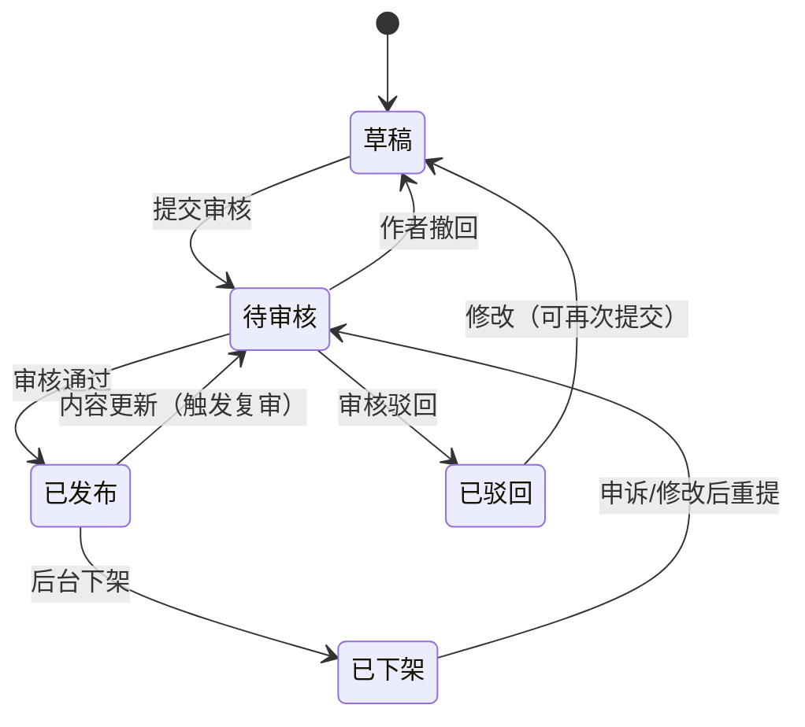

# 喵站 · 编程学习网站 任务书（需求文档）

| 文档信息 | |
| --- | --- |
| 项目名称 | 喵站（编程学习网站） |
| 文档版本 | v1.0 |
| 文档状态 | 评审稿 |
| 当前阶段 | 开发版（Development） |
| 编写日期 | 2026-09-30 |
| 适用范围 | 本任务书覆盖「开发版」全量需求；上线版仅做方向性规划 |

---

## 1. 项目概述

### 1.1 背景与定位

喵站是一个**编程学习网站**，以结构化图文教程为核心内容形态：

- **内容形态参考菜鸟教程（runoob）**：按「教程 → 章节 → 知识点文章」组织的体系化编程教程，覆盖多门语言/技术栈，每篇内容短小聚焦、配代码示例。
- **使用方式与信息架构参考 B 站的文档（专栏）模式**：首页分区推荐 + 顶部分类导航 + 全局搜索；阅读页三栏布局（左侧目录树 / 中间正文 / 右侧大纲与作者卡）；用户可投稿创作，创作需审核，配创作中心与消息通知。

一句话定位：**像刷 B 站专栏一样刷编程教程，人人可申请成为教程作者。**

### 1.2 项目目标

1. 提供体系化、可检索、可追踪进度的编程教程阅读体验。
2. 建立「用户 → 老师 → 审核」的内容生产闭环，保证内容质量可控。
3. 当前阶段交付**开发版**：完成两个核心模块 —— **喵站（前台）** 与 **后台管理系统**，跑通全部功能闭环，达到可内部试用标准。

### 1.3 名词定义

| 名词 | 定义 |
| --- | --- |
| 教程 | 一门完整课程，含元信息（标题/分类/封面/简介/难度/标签）与若干章节 |
| 章节 | 教程下的单篇图文内容（Markdown），最小阅读单元 |
| 老师 | 通过申请审核、获得教程发布权限的用户 |
| 审核 | 后台对「老师申请 / 新教程 / 教程更新 / 举报」进行的通过/驳回操作 |
| 游客 | 未登录状态的访问者 |
| 前台 / 喵站 | 面向所有用户的内容展示与浏览入口 |
| 后台 / 管理系统 | 面向审核员与管理员的管理操作入口 |

---

## 2. 角色与权限模型

### 2.1 角色定义

| 角色 | 说明 | 获得方式 |
| --- | --- | --- |
| 游客 | 未登录访问者 | 默认 |
| 注册用户（学员） | 已登录普通用户 | 邮箱注册 |
| 老师 | 可创作并提交教程的用户 | 申请 + 后台审核通过 |
| 审核员 | 处理审核队列、举报 | 管理员授权 |
| 管理员 | 拥有全部后台权限 | 系统初始化指定 |

### 2.2 权限矩阵（前台 + 后台）

| 功能 | 游客 | 注册用户 | 老师 | 审核员 | 管理员 |
| --- | --- | --- | --- | --- | --- |
| 浏览首页/分类/教程/章节 | ✅ | ✅ | ✅ | ✅ | ✅ |
| 全局搜索 | ✅ | ✅ | ✅ | ✅ | ✅ |
| 注册/登录/找回密码 | ✅ | — | — | — | — |
| 学习进度云端同步 | ❌（仅本地） | ✅ | ✅ | ✅ | ✅ |
| 收藏 / 笔记 | ❌ | ✅ | ✅ | ✅ | ✅ |
| 申请成为老师 | ❌ | ✅ | — | — | — |
| 创建/编辑/提交教程 | ❌ | ❌ | ✅ | ❌ | ✅ |
| 查看自己教程的审核状态与数据 | ❌ | ❌ | ✅ | ❌ | ✅ |
| 审核老师申请 / 教程 / 更新 | ❌ | ❌ | ❌ | ✅ | ✅ |
| 处理举报 | ❌ | ❌ | ❌ | ✅ | ✅ |
| 用户管理（封禁/角色） | ❌ | ❌ | ❌ | ❌ | ✅ |
| 分类/标签/公告/轮播管理 | ❌ | ❌ | ❌ | ❌ | ✅ |
| 后台账号与权限管理 | ❌ | ❌ | ❌ | ❌ | ✅ |
| 查看操作日志 | ❌ | ❌ | ❌ | ❌ | ✅ |

---

## 3. 总体信息架构

### 3.1 站点地图 —— 前台（喵站）

```
首页
├── 分类导航（按技术分区：前端 / 后端 / 移动端 / 数据库 / 运维 / AI ...）
│   └── 分类页（该分类下教程列表：最新 / 最热 / 难度筛选）
├── 教程封面页（简介、目录、作者卡、学习人数）
│   └── 章节阅读页（三栏：目录树 / 正文 / 大纲 + 上一篇·下一篇）
├── 搜索结果页（教程 / 章节 / 作者 三个 Tab）
├── 登录 / 注册 / 找回密码（可跳过，继续游客浏览）
├── 个人中心（右上角头像进入）
│   ├── 个人资料
│   ├── 我的学习（学习进度 / 收藏 / 笔记）
│   ├── 消息中心
│   ├── 申请成为老师 / 申请进度
│   ├── 创作中心（仅老师可见）
│   │   ├── 我的教程列表
│   │   ├── 教程编辑器（新建 / 编辑 / 章节管理）
│   │   └── 数据概览（阅读量 / 收藏 / 完成率）
│   └── 账号设置（改密码 / 换绑邮箱 / 注销）
└── 404 / 500 / 维护页
```

### 3.2 站点地图 —— 后台管理系统

```
后台登录页（独立账号体系鉴权）
├── 仪表盘（待审数量 / 今日新增 / 趋势图）
├── 审核中心
│   ├── 老师申请审核
│   ├── 新教程审核
│   ├── 教程更新审核
│   └── 举报处理
├── 内容管理（教程列表：上架 / 下架 / 推荐位 / 分类调整）
├── 用户管理（列表 / 详情 / 封禁·解封 / 角色调整）
├── 分类与标签管理
├── 运营位管理（首页轮播 / 公告）
├── 数据统计（用户 / 内容 / 学习行为）
├── 系统设置（审核规则文案 / 协议维护 / 限流参数）
└── 操作日志
```

### 3.3 全局导航规则

- 顶部导航恒显：**Logo ｜ 分类入口 ｜ 全局搜索框 ｜ 消息图标 ｜ 头像区（右上角个人信息中心）**。
- 右上角头像区两种状态：
  - 未登录：「登录 / 注册」按钮 + 「跳过，继续浏览」入口。
  - 已登录：头像 + 下拉菜单（个人资料 / 我的学习 / 消息中心 / 创作中心*老师* / 申请成为老师*非老师* / 账号设置 / 退出登录）。
- 后台管理系统使用独立域名或独立路由前缀（如 `/admin`），与前台完全分离的会话与布局。

---

## 4. 版本规划

| 版本 | 范围 | 目标 |
| --- | --- | --- |
| **开发版（当前）** | 两个核心模块：`开发版/喵站`（前台）、`开发版/后台管理系统` | 跑通全部功能闭环，内部可试用；数据可用 SQLite 本地库 |
| 上线版 | 开发版功能 + 生产化（正式数据库、对象存储、CDN、邮件服务、监控、备案合规） | 对外发布 |

开发版目录约定：

```
喵站/                          ← 项目根（可位于任意磁盘路径）
├── 任务书.md                ← 本文档
├── 开发版/
│   ├── 喵站/                ← 核心模块①：前台（内容展示与浏览入口）
│   └── 后台管理系统/        ← 核心模块②：后台（审核等管理操作）
└── 上线版/                  ← 后续阶段
```

---

## 5. 端到端功能流程

> 本节列出从用户进入到各功能闭环的全部流程。F 编号为流程编号，供开发与测试引用。

### F1 游客浏览主流程（可跳过登录）

1. 用户进入首页 → 展示轮播、推荐教程、各分类热门、最新上架。
2. 点击分类 → 分类页 → 筛选/排序 → 点击教程 → 教程封面页。
3. 点击「开始学习」→ 章节阅读页 → 上一篇/下一篇连贯阅读。
4. 触发需登录行为（收藏 / 笔记 / 进度同步 / 评论*P1*）→ 弹出登录引导层。
5. 引导层提供：「去登录 / 去注册 / **暂不登录，继续浏览**」——游客可跳过，继续阅读不受影响。
6. 游客限制：学习进度仅存浏览器本地；收藏、笔记、评论不可用；关闭页面后本地进度可选保留。

### F2 注册与登录闭环（邮箱体系）

**注册：**
1. 登录页切换至「注册」→ 输入昵称、邮箱、密码（两次确认）。
2. 点击「发送验证码」→ 60s 倒计时防重发 → 邮箱收到 6 位验证码（10 分钟有效）。
3. 输入验证码 → 勾选《用户协议》与《隐私政策》→ 提交。
4. 校验通过 → 注册成功并自动登录 → 跳回来源页。
5. 若此前为游客且本地有学习进度 → 提示「检测到本地学习记录，是否合并到账号？」→ 合并/放弃。

**登录：**
1. 邮箱 + 密码登录；或邮箱 + 验证码快捷登录。
2. 连续 5 次密码错误 → 锁定 15 分钟并提示走「忘记密码」。
3. 登录成功 → 跳回来源页；若来源页为后台 → 校验后台角色，无权限则拒绝。

**忘记密码：**
1. 输入邮箱 → 验证码 → 设置新密码 → 原会话全部失效。

**状态与异常：** 验证码收不到（重发 / 检查垃圾箱提示 / 更换邮箱）、验证码错误 5 次失效、邮箱已注册引导直接登录、网络异常可重试不丢输入。

### F3 学习浏览闭环

1. 分类导航 → 教程封面页（简介 / 章节目录 / 作者卡 / 学习人数 / 难度 / 最近更新）。
2. 「开始学习」或点选章节 → 阅读页：
   - 左侧：教程目录树（当前章节高亮、已完成章节打勾）。
   - 中间：正文（Markdown 渲染、代码高亮、一键复制代码、图片放大）。
   - 右侧：本篇大纲锚点 + 作者卡 + 「上一篇 / 下一篇」。
3. 滚动到底部或点击「标记完成」→ 记录学习进度（登录用户写云端，游客写本地）。
4. 阅读中可：收藏教程、对当前章节写笔记（私有）、回到目录。
5. 完成全部章节 → 教程标记「已学完」→ 封面页与个人中心展示完成徽章。
6. 中途退出 → 再次进入该教程 → 自动定位到上次学习章节并提示「继续学习」。

### F4 搜索闭环

1. 全局搜索框输入 → 下拉联想（教程名 / 章节标题 / 作者）。
2. 回车 → 结果页三个 Tab：教程 / 章节 / 作者。
3. 支持筛选：分类、难度、更新时间；排序：相关度 / 最新 / 最热。
4. 点击结果 → 直达封面页或具体章节（章节结果高亮命中词）。
5. 无结果 → 展示相近词纠错 + 热门推荐 + 「求教程」反馈入口*P1*。
6. 登录用户保留最近 10 条搜索历史，可清空。

### F5 个人中心闭环（右上角入口）

1. 点击右上角头像 → 下拉菜单 / 个人中心首页。
2. 个人资料：修改昵称、头像、简介；查看角色身份（学员 / 老师）。
3. 我的学习：学习中的教程（含进度条）、已学完、收藏列表、笔记列表（可跳转回原章节锚点）。
4. 消息中心：系统通知、审核结果通知、互动通知*P1*；支持全部已读。
5. 账号设置：修改密码（需旧密码）、换绑邮箱（双邮箱验证）、账号注销（7 天冷静期）。

### F6 老师申请闭环

1. 入口：个人中心「申请成为老师」（已是老师则显示「创作中心」）。
2. 申请表：真实称呼、擅长技术领域（多选）、个人介绍、**样例作品**（在线编写或粘贴链接）、勾选《内容创作协议》。
3. 提交 → 状态「审核中」，期间不可重复提交，可在申请进度页查看或**撤回**。
4. 后台审核（见 F8）→ 结果以站内消息 + 邮件通知：
   - **通过** → 角色升级为老师，个人中心出现「创作中心」，申请页展示欢迎引导。
   - **驳回** → 展示驳回原因，允许修改资料后**重新提交**（同一用户 30 天内最多提交 3 次）。

### F7 教程创作与发布闭环（老师）

1. 创作中心 → 「新建教程」→ 填写元信息：标题、分类、标签、封面、简介、难度、适合人群。
2. 进入编辑器 → 章节管理（增删、拖拽排序）→ 单章编辑：Markdown 编辑器 + 实时预览 + 草稿自动保存（本地 + 云端双保险）。
3. 全部章节就绪 → 「提交审核」→ 状态机流转：



4. 审核期间：内容锁定只读；作者可「撤回」回草稿。
5. 审核通过 → 教程上架，出现在分类页 / 搜索 / 首页推荐候选池；作者收到通知。
6. 已发布教程的**任何内容变更需重新提交审核**；审核期间线上保留旧版本，新内容通过后无缝替换（用户端无感知）。
7. 数据概览：阅读量、收藏数、学习完成率、章节完读率，按日更新。

### F8 后台审核闭环

1. 审核员登录后台 → 仪表盘显示各待审队列数量。
2. 进入对应队列（老师申请 / 新教程 / 教程更新 / 举报），列表支持：提交时间排序、按申请人/分类筛选、认领（防多人同时审同一单）。
3. 审核详情页：
   - 老师申请：申请资料 + 样例作品内容 + 该用户历史记录。
   - 教程：元信息 + 全部章节正文渲染预览 + 与上一版本差异对比（更新审核时）。
   - 对照《内容审核规范》（第 7 章）检查清单逐项确认。
4. 操作：**通过** / **驳回（必选预设原因模板 + 可补充说明）**；驳回原因将原文同步给作者。
5. 提交 → 写入审核日志（操作人、时间、结论、原因）→ 触发站内消息 + 邮件通知申请人。
6. 支持批量通过（仅限明显合规项，如低风险举报结案）；批量操作二次确认。

### F9 用户与运营管理闭环（管理员）

1. 用户管理：搜索用户 → 查看详情（角色、教程、违规记录）→ 封禁（选期限 + 原因）/ 解封 / 调整角色（含授予、取消老师资格，取消其全部教程下架联动）。
2. 举报处理：用户对教程/章节发起举报（选择类型：违法违规 / 抄袭 / 广告 / 内容错误 / 其他）→ 进入举报队列 → 审核员核实 → 处理结果（下架 / 驳回举报 / 警告作者）→ 通知举报人与被举报人。
3. 分类与标签管理：增删改、排序、合并标签；分类调整自动迁移教程归属。
4. 运营位管理：首页轮播与公告的上下架、排序、定时生效。
5. 操作日志：后台一切写操作留痕，可按人 / 按对象 / 按时间检索。

### F10 边界与异常流程

| 场景 | 处理 |
| --- | --- |
| 账号被封禁后登录 | 提示封禁原因与期限，前台全部只读，创作入口隐藏 |
| 老师资格被取消 | 其名下教程全部下架（保留数据），前台身份变回学员 |
| 审核中作者撤回 | 队列中该单标记「已撤回」，审核员不可再操作 |
| 同一账号多地登录 | 后登录挤掉前会话（学习类站点默认允许 2 端并存，可在设置中查看登录设备并踢出） |
| 草稿丢失 | 编辑器每 30s 自动保存云端 + 本地 localStorage 双备份，异常关闭后恢复提示 |
| 邮件服务不可用 | 验证码接口降级：返回明确错误并允许稍后重试，不吞用户输入 |
| 游客转注册 | 本地学习进度合并策略见 F2-注册-5 |

---

## 6. 页面清单与模块规划

### 6.1 前台（喵站）页面清单

| 编号 | 页面 | 建议路由 | 核心模块 | 权限 |
| --- | --- | --- | --- | --- |
| P-01 | 首页 | `/` | 轮播、推荐教程、分类热门、最新上架、页脚 | 全部 |
| P-02 | 分类页 | `/category/:id` | 教程卡片列表、难度/排序筛选、分页 | 全部 |
| P-03 | 教程封面页 | `/tutorial/:id` | 简介、章节目录、作者卡、学习人数、开始学习/继续学习 | 全部 |
| P-04 | 章节阅读页 | `/tutorial/:id/:chapterId` | 左目录树、正文渲染、代码复制、右大纲、上下篇、收藏、笔记、标记完成 | 全部（交互项需登录） |
| P-05 | 搜索结果页 | `/search?q=` | 三 Tab、筛选、纠错、历史 | 全部 |
| P-06 | 登录 | `/login` | 密码登录、验证码登录、跳过入口 | 游客 |
| P-07 | 注册 | `/register` | 邮箱验证码、协议勾选 | 游客 |
| P-08 | 找回密码 | `/reset-password` | 验证码 + 重置 | 游客 |
| P-09 | 个人资料 | `/u/profile` | 昵称/头像/简介编辑 | 登录 |
| P-10 | 我的学习 | `/u/learning` | 学习中/已学完/收藏/笔记 | 登录 |
| P-11 | 消息中心 | `/u/messages` | 通知列表、已读管理 | 登录 |
| P-12 | 老师申请页 | `/u/apply-teacher` | 申请表单 / 申请进度 / 驳回原因 | 登录 |
| P-13 | 创作中心 - 教程列表 | `/studio/tutorials` | 状态分组列表、新建入口、数据列 | 老师 |
| P-14 | 创作中心 - 编辑器 | `/studio/editor/:id` | 元信息表单、章节管理、Markdown 编辑器、预览、提交审核/撤回 | 老师 |
| P-15 | 创作中心 - 数据概览 | `/studio/stats` | 阅读量/收藏/完成率图表 | 老师 |
| P-16 | 账号设置 | `/u/settings` | 改密码、换绑邮箱、登录设备、注销 | 登录 |
| P-17 | 异常页 | `404 / 500` | 返回首页、搜索建议 | 全部 |

全局组件：顶部导航栏（含搜索与头像区）、登录引导弹层、页脚（关于 / 协议 / 联系方式）、回到顶部、举报弹窗。

### 6.2 后台管理系统页面清单

| 编号 | 页面 | 建议路由 | 核心模块 | 权限 |
| --- | --- | --- | --- | --- |
| A-01 | 后台登录 | `/admin/login` | 账号密码 + 图形验证码 | 审核员/管理员 |
| A-02 | 仪表盘 | `/admin` | 待审卡片、今日新增、7 日趋势图 | 审核员/管理员 |
| A-03 | 老师申请审核 | `/admin/review/teacher` | 队列、详情、通过/驳回 | 审核员/管理员 |
| A-04 | 教程审核（新/更新） | `/admin/review/tutorials` | 队列、全文预览、版本 Diff、通过/驳回 | 审核员/管理员 |
| A-05 | 举报处理 | `/admin/reports` | 队列、证据详情、处理动作 | 审核员/管理员 |
| A-06 | 内容管理 | `/admin/content` | 教程检索、上架/下架、推荐位设置 | 管理员 |
| A-07 | 用户管理 | `/admin/users` | 检索、详情、封禁、角色调整 | 管理员 |
| A-08 | 分类与标签 | `/admin/taxonomy` | 树形管理、合并、排序 | 管理员 |
| A-09 | 运营位管理 | `/admin/ops` | 轮播、公告、定时上下架 | 管理员 |
| A-10 | 数据统计 | `/admin/stats` | 用户增长、内容量、学习行为 | 管理员 |
| A-11 | 系统设置 | `/admin/settings` | 审核文案、协议、限流参数 | 管理员 |
| A-12 | 操作日志 | `/admin/logs` | 多条件检索、详情 | 管理员 |

---

## 7. 内容审核规范（审核员执行依据）

### 7.1 审核检查清单

1. **合规红线**：违法违规、政治敏感、色情暴力、赌博诈骗 → 一律驳回并记录，情节重封号。
2. **版权**：明显抄袭/洗稿、未授权转载 → 驳回；要求作者声明原创或附授权。
3. **广告与导流**：站外引流二维码、推广链接泛滥 → 驳回。
4. **内容质量底线**：与标题不符、内容空洞（如纯 Hello World 拼凑）、代码无法运行且未说明 → 驳回。
5. **安全**：恶意代码（病毒、钓鱼、破坏型脚本）→ 驳回 + 警告；教学用安全示例需有明确提示。
6. **排版规范**：Markdown 结构完整、代码块标注语言、图片可访问。

### 7.2 驳回原因模板（预设）

- 内容违规（含具体条款）
- 涉嫌抄袭/未授权转载
- 含站外导流或广告
- 内容质量不达标（说明具体缺口）
- 代码存在安全风险
- 其他（自定义说明，必填）

### 7.3 处罚梯度

提醒 → 驳回并警告 → 教程下架 → 取消老师资格 → 封禁账号。每步均留日志并通知当事人；作者对下架/取消资格可发起一次**申诉**，由管理员复核。

---

## 8. 功能需求清单（FR）

> P0 = 开发版必须；P1 = 开发版尽量；P2 = 上线版候选。

### 8.1 认证与账号（AUTH）

| 编号 | 需求 | 优先级 |
| --- | --- | --- |
| FR-AUTH-01 | 邮箱 + 验证码注册（昵称、密码、协议勾选） | P0 |
| FR-AUTH-02 | 邮箱 + 密码登录 | P0 |
| FR-AUTH-03 | 邮箱 + 验证码快捷登录 | P1 |
| FR-AUTH-04 | 忘记密码（验证码重置） | P0 |
| FR-AUTH-05 | 登录引导弹层「跳过，继续浏览」 | P0 |
| FR-AUTH-06 | 连续错误锁定与验证码防刷限流 | P0 |
| FR-AUTH-07 | 修改密码 / 换绑邮箱 / 账号注销（冷静期） | P1 |
| FR-AUTH-08 | 游客本地进度合并到账号 | P1 |

### 8.2 浏览与学习（LEARN）

| 编号 | 需求 | 优先级 |
| --- | --- | --- |
| FR-LEARN-01 | 首页（轮播 / 推荐 / 分类热门 / 最新） | P0 |
| FR-LEARN-02 | 分类导航与分类页（筛选 / 排序 / 分页） | P0 |
| FR-LEARN-03 | 教程封面页（目录 / 作者卡 / 开始学习） | P0 |
| FR-LEARN-04 | 章节阅读页三栏布局、上下篇导航 | P0 |
| FR-LEARN-05 | Markdown 渲染、代码高亮、一键复制 | P0 |
| FR-LEARN-06 | 学习进度记录与「继续学习」定位 | P0 |
| FR-LEARN-07 | 收藏教程 | P0 |
| FR-LEARN-08 | 章节笔记（私有，可回跳锚点） | P1 |
| FR-LEARN-09 | 完成徽章 / 已学完标记 | P1 |

### 8.3 搜索（SEARCH）

| 编号 | 需求 | 优先级 |
| --- | --- | --- |
| FR-SEARCH-01 | 全局搜索（教程/章节/作者） | P0 |
| FR-SEARCH-02 | 结果页 Tab + 筛选 + 排序 | P0 |
| FR-SEARCH-03 | 输入联想 | P1 |
| FR-SEARCH-04 | 搜索历史与无结果推荐 | P1 |

### 8.4 个人中心（UC）

| 编号 | 需求 | 优先级 |
| --- | --- | --- |
| FR-UC-01 | 右上角头像下拉菜单（含角色相关入口） | P0 |
| FR-UC-02 | 个人资料编辑 | P0 |
| FR-UC-03 | 我的学习（进度/收藏/笔记聚合） | P0 |
| FR-UC-04 | 消息中心（系统/审核通知） | P0 |
| FR-UC-05 | 全部已读、通知分类 Tab | P1 |

### 8.5 老师与创作（TEACH）

| 编号 | 需求 | 优先级 |
| --- | --- | --- |
| FR-TEACH-01 | 老师申请表单与进度页 | P0 |
| FR-TEACH-02 | 申请撤回与驳回后重提（30 天 ≤ 3 次） | P0 |
| FR-TEACH-03 | 创作中心教程列表（按状态分组） | P0 |
| FR-TEACH-04 | 教程元信息编辑 | P0 |
| FR-TEACH-05 | 章节管理（增删、排序） | P0 |
| FR-TEACH-06 | Markdown 编辑器 + 实时预览 + 自动保存 | P0 |
| FR-TEACH-07 | 提交审核 / 审核中撤回 | P0 |
| FR-TEACH-08 | 已发布内容更新触发复审、线上保留旧版 | P0 |
| FR-TEACH-09 | 驳回原因展示与修改后重提 | P0 |
| FR-TEACH-10 | 创作数据概览 | P1 |

### 8.6 后台管理（ADMIN）

| 编号 | 需求 | 优先级 |
| --- | --- | --- |
| FR-ADMIN-01 | 后台独立登录与角色鉴权 | P0 |
| FR-ADMIN-02 | 仪表盘待审统计 | P0 |
| FR-ADMIN-03 | 老师申请审核（通过/驳回+原因） | P0 |
| FR-ADMIN-04 | 教程审核（新提交 / 更新） | P0 |
| FR-ADMIN-05 | 更新审核的版本差异对比 | P1 |
| FR-ADMIN-06 | 审核认领与冲突提示 | P1 |
| FR-ADMIN-07 | 举报处理闭环 | P1 |
| FR-ADMIN-08 | 内容管理（上架/下架/推荐位） | P0 |
| FR-ADMIN-09 | 用户管理（封禁/解封/角色调整） | P0 |
| FR-ADMIN-10 | 分类与标签管理 | P0 |
| FR-ADMIN-11 | 运营位（轮播/公告）管理 | P1 |
| FR-ADMIN-12 | 操作日志留痕与检索 | P0 |
| FR-ADMIN-13 | 数据统计看板 | P2 |

### 8.7 互动（P1 起，可整体后置）

| 编号 | 需求 | 优先级 |
| --- | --- | --- |
| FR-SOC-01 | 章节评论 | P1 |
| FR-SOC-02 | 教程评分 | P2 |
| FR-SOC-03 | 「求教程」反馈 | P2 |

---

## 9. 非功能需求

| 类别 | 要求 |
| --- | --- |
| 性能 | 首屏 < 2s（本地开发环境除外按生产指标定）；阅读页打开 < 1.5s；列表分页 ≤ 20/页 |
| 安全 | 密码 Argon2/bcrypt 加密；会话 JWT + 刷新令牌；验证码/登录/提交审核接口限流；富文本渲染 XSS 白名单过滤；后台全部接口服务端鉴权；CSRF 防护 |
| 隐私 | 邮箱在界面展示脱敏（`f***@xx.com`）；注销后按协议删除或匿名化个人数据 |
| SEO | 教程与章节页支持 SSR 或预渲染；语义化 HTML；自动生成 sitemap |
| 兼容性 | Chrome / Edge / Firefox / Safari 最近两个大版本；移动端响应式可读 |
| 可用性 | 表单错误就地提示；危险操作二次确认；网络失败不丢用户输入 |
| 数据 | 开发版 SQLite；每日逻辑备份；后台写操作全量日志 |

---

## 10. 数据实体草案

| 实体 | 关键字段 |
| --- | --- |
| user | id, email, password_hash, nickname, avatar, role(student/teacher/reviewer/admin), status, created_at |
| email_code | id, email, code, scene(register/login/reset), expires_at, used |
| teacher_application | id, user_id, fields(json), status(pending/approved/rejected/withdrawn), reason, reviewed_by, reviewed_at |
| category | id, name, slug, sort, parent_id |
| tag | id, name |
| tutorial | id, author_id, title, category_id, cover, intro, difficulty, status(状态机见 F7), version, published_at |
| chapter | id, tutorial_id, title, content_md, sort, status |
| tutorial_version | id, tutorial_id, snapshot(json), status, submitted_at（用于更新复审与线上旧版保留） |
| review_record | id, target_type, target_id, reviewer_id, action, reason, created_at |
| learning_progress | id, user_id(可空→游客本地), tutorial_id, chapter_id, completed, updated_at |
| favorite | id, user_id, tutorial_id, created_at |
| note | id, user_id, chapter_id, content, anchor, created_at |
| message | id, user_id, type, title, body, read, created_at |
| report | id, reporter_id, target_type, target_id, type, detail, status, handled_by |
| announcement / banner | id, title, content/image, link, sort, starts_at, ends_at |
| admin_log | id, admin_id, action, target, detail, ip, created_at |

---

## 11. 技术架构建议（待主管拍板）

| 层 | 方案 A（推荐，与 Mindbox 技术亲和） | 方案 B |
| --- | --- | --- |
| 前端 | Vue 3 + Vite + Pinia + Vue Router；阅读页 SSR/预渲染选 Nuxt | React + Next.js |
| 后台 UI | Element Plus（管理端表格表单快） | Ant Design React |
| 后端 | Python FastAPI + SQLAlchemy | Node NestJS |
| 数据库 | 开发版 SQLite → 上线版 PostgreSQL/MySQL | 同左 |
| 全文搜索 | 开发版 SQLite FTS5 → 上线 Meilisearch | 同左 |
| Markdown | 渲染统一管线 + Shiki/highlight.js 代码高亮；编辑器 Vditor / md-editor-v3 | 同左 |
| 邮件 | 开发版 SMTP 直连（或 MailHog 本地捕获）→ 上线版邮件服务 | 同左 |
| 部署 | 开发版本地起服务 → 上线版 Docker + Nginx | 同左 |

---

## 12. 验收标准（开发版）

1. F1–F9 全部主流程可按本文档步骤走通，无阻断性缺陷。
2. 权限矩阵逐项核对通过：越权访问前后台接口均被拒绝并正确提示。
3. 教程状态机（F7）全部流转路径有对应界面与通知触达。
4. 审核驳回必须带预设原因，且作者端可见原文。
5. 游客全流程不强制登录，跳过入口始终可见。
6. 后台所有写操作在操作日志中可查。
7. 第 8 章全部 P0 项完成；P1 项完成度 ≥ 70%，未完成项列入上线版清单。

---

## 13. 里程碑

| 里程碑 | 内容 | 验收 |
| --- | --- | --- |
| M1 骨架与认证 | 两模块工程初始化、路由、布局、注册/登录/找回 | F2 走通 |
| M2 内容浏览 | 首页、分类、封面页、阅读页、搜索 | F1/F3/F4（游客）走通 |
| M3 个人中心 | 资料、我的学习、消息、进度同步 | F5 走通 |
| M4 老师申请与创作 | 申请流、创作中心、编辑器、提交审核 | F6、F7（提交前）走通 |
| M5 后台审核与管理 | 审核队列、驳回通知、用户/分类/内容管理 | F8、F9 走通 |
| M6 联调验收 | 全流程回归、权限核对、文档补齐 | 第 12 章全过 |

---

## 14. 风险与开放问题

| 项 | 说明 | 建议 |
| --- | --- | --- |
| 评论功能是否进开发版 | 当前定为 P1，范围大 | M3 评审时再定 |
| 视频教程 | 本期仅图文，不支持视频 | 上线版再议 |
| 审核 SLA | 待审积压体验差 | 后台设 48h 超时提醒*P1* |
| 内容冷启动 | 无老师时无内容 | 管理员账号兼任首批作者，预置 3–5 门基础教程 |
| 邮件送达率 | 验证码进垃圾箱影响注册转化 | 注册页加引导提示；上线版换专业邮件服务 |

---

*本任务书为开发版唯一需求基准。后续变更需在本文件修订并升版本号。*
